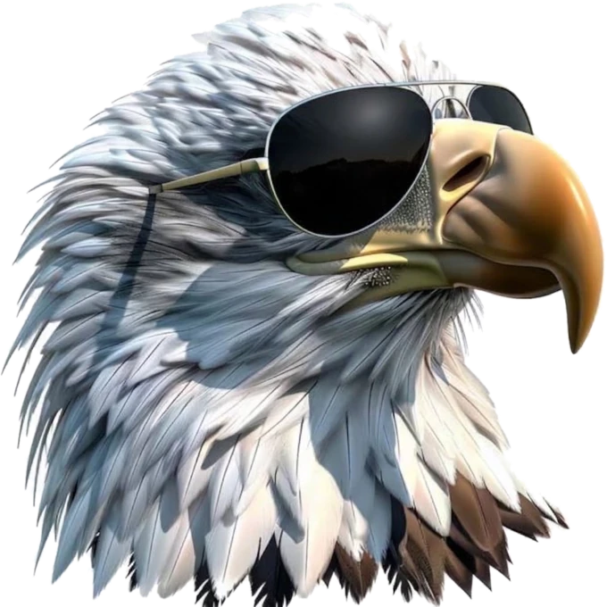
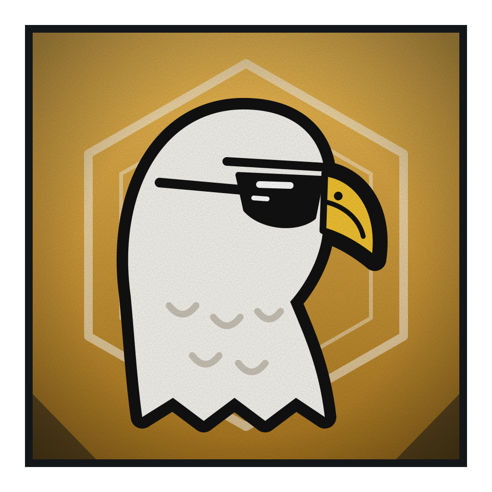

# Águia Disciplinada

**O Mais Forte dos Heróis**

 

> “Disciplina é escolher de novo, todo dia.”

| Lado | Classificação | Função | Série |
|---|---|---|---|
| Herói | Especial | Herói supremo | Temporada 1 |

## Atributos

_Escala de 0 a 5_

| Atributo | Valor |
|---|:-:|
| Força | 4 |
| Velocidade | 5 |
| Inteligência | 5 |
| Resistência | 4 |
| Energia | 5 |
| Destruição | 5 |
| Potencial | 5 |

## Técnicas

- _Inata_ · **Disciplina**  
  Barreira que impede qualquer toque enquanto ele mantém o foco.
- **Olhos da Águia**  
  Percepção total. Vê o fluxo de energia, mentiras e brechas. Só em plena força sem os óculos.
- _Autolimitação_ · **Óculos Escuros**  
  Usa o tempo todo para limitar os olhos e poupar energia. Na luta, ele os tira.
- **Voo em Picada**  
  Mergulho em velocidade altíssima, com a barreira como escudo. Seu ataque principal.
- **Ritmo**  
  Quanto mais repete uma técnica na luta, mais forte e eficiente ela fica.
- **Garra Cirúrgica**  
  Golpe de precisão no ponto fraco que os olhos encontraram.
- **Palavra Dada**  
  Anuncia o que vai fazer. Cumprir o fortalece, falhar o enfraquece.
- _Atração_ · **Rumo**  
  Fixa um ponto como destino e puxa tudo para ele, como garras se fechando.
- _Repulsão_ · **Limite**  
  Traça uma linha que nada pode cruzar e empurra tudo para fora dela.
- _Fusão · Rumo + Limite_ · **Trajetória Perfeita**  
  Une atração e repulsão num único caminho. Tudo na trajetória é apagado. Exige foco total.
- _Domínio de expansão_ · **Horizonte do Que Poderia Ter Sido**  
  Mostra à vítima a vida inteira e cada chance perdida. Encerra a luta pela mente, sem matar.

## Pontos fracos

- _Limitação_ · **Disciplina Frágil**  
  A barreira cai com distração, raiva, riso, fome ou sono.
- _Limitação_ · **Preparo Exposto**  
  Enquanto carrega a Trajetória Perfeita, a barreira cai e ele fica vulnerável.
- _Limitação_ · **Uso Único**  
  O domínio funciona uma única vez contra cada alvo. Quem já se arrependeu, se redimiu ou negou não é afetado de novo.
- _Limitação_ · **Resultado Incontrolável**  
  Não controla se o domínio termina em redenção, frustração ou negação.
- _Consequência_ · **Esgotamento do Domínio**  
  Depois do domínio, a barreira cai por um tempo e ele sente os arrependimentos da vítima.
- _Custo_ · **Olhos Exigentes**  
  Sem os óculos, os olhos gastam energia e causam dor de cabeça.
