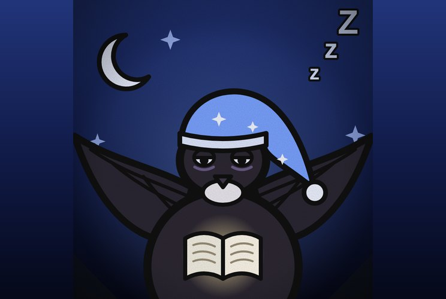

# Andorrinhão-Conto

**Especialista Sonolento por Tempo Limitado**

 

> “Só mais cinco minutinhos. Depois eu aprendo tudo.”

| Lado | Classificação | Função | Série |
|---|---|---|---|
| — | Grau 2 · No assunto: Grau 1 | Consultor · Lado a definir | Temporada 1 |

## Atributos

_Escala de 0 a 5, por postura_

| Atributo | Acordado ★ | Hiperfoco | Dormindo |
|---|:-:|:-:|:-:|
| Força | 2 | 2 | 4 |
| Velocidade | 4 | 4 | 5 |
| Inteligência | 4 | 5 | 2 |
| Resistência | 2 | 2 | 2 |
| Energia | 3 | 4 | 3 |
| Destruição | 2 | 3 | 4 |
| Potencial | 4 | 4 | 4 |

- **Acordado**: Acordado
- **Hiperfoco**: Hiperfoco
- **Dormindo**: Dormindo

## Quem ele é

- _Inata_ · **Dorminhoco**  
  Adora dormir. Prefere uma cama, uma rede ou uma nuvem macia a qualquer luta.
- _Inata_ · **Sono Planador**  
  Dorme em pleno voo, planando sem cair, como um andorinhão de verdade. Quase nunca pousa.

## Acordado

- _Inata_ · **Mente Afiada**  
  Acordado, ele é inteligente: pensa rápido, aprende rápido e enxerga o que os outros não veem.
- _Técnica_ · **Hiperfoco**  
  Escolhe um assunto e vira especialista nele por tempo limitado. A inteligência dispara e ele domina tudo daquele assunto. Nos assuntos que ele não gosta, o Hiperfoco é uma reserva de tempo que se gasta.
- _Técnica_ · **Biblioteca da Mente**  
  Escolhe, na própria mente, um assunto que já conhece e ativa o Hiperfoco sobre ele na hora, sem estudar de novo. Só vale para o que ele ainda guarda: os assuntos de que gosta e o assunto ativo.
- _Técnica_ · **Gostos Não Gastam**  
  Nos assuntos de que ele gosta, o Hiperfoco é natural: está sempre ativo, não gasta e o conhecimento nunca se perde. Para os assuntos de que não gosta, tem que gastar Hiperfoco.
- _Domínio · Acordado_ · **Sobrecarga de Hiperfoco**  
  Expansão de domínio: a vítima fica sobrecarregada com Hiperfoco em TUDO ao mesmo tempo. Não aguenta tanta informação e fica paralisada por muito tempo.

## Dormindo

- _Técnica_ · **Lutador Adormecido**  
  Dormindo, ele luta por instinto: fica rápido e forte. A resistência não aumenta.
- _Domínio · Dormindo_ · **Conto de Ninar**  
  Expansão de domínio: a vítima fica com tanto sono e cansaço que dorme por muito tempo.

## Mais técnicas

- _Técnica_ · **Um Assunto por Vez**  
  Só um assunto de que ele não gosta fica ativo no Hiperfoco. Trocar por outro faz ele perder o conhecimento do anterior. Os assuntos de que gosta continuam com ele.
- _Técnica_ · **Especialista por Encomenda**  
  Os aliados dão o assunto: uma técnica inimiga, um idioma, um mapa, uma fechadura, um motor, uma anatomia. A Garça Entregadora leva os livros e os materiais.
- _Técnica_ · **Conto do Especialista**  
  Quando termina, conta o que aprendeu e explica de forma simples aos aliados, passando o essencial.
- _Técnica_ · **Hiperfoco em Combate**  
  Escolhe a técnica do inimigo como assunto, descobre como ela funciona e acha a brecha.
- _Técnica_ · **Voo Sem Pouso**  
  Voa muito rápido e por muito tempo sem pousar. Entrega recados e chega antes de quase todo mundo.
- _Técnica_ · **Asa Foice**  
  As asas longas em foice cortam o ar em passagens rápidas, acordado ou dormindo.
- _Técnica_ · **Dormir de Propósito**  
  Pode adormecer quando quer, para entrar no modo Dormindo. Dormir também apaga todos os efeitos negativos que ele acumulou.

## Pontos fracos

- _Fraqueza_ · **Dorme Demais**  
  Dorme a qualquer hora e em qualquer lugar, até no meio de uma conversa ou de uma luta. O sono é pesado e difícil de interromper.
- _Fraqueza_ · **Adora Dormir**  
  Prefere dormir a agir. Recusa missão que o acorde cedo e aceita pagamento em soneca.
- _Fraqueza_ · **Forte, Mas Frágil**  
  Dormindo, a resistência continua a mesma de acordado. Ele luta só por instinto, sem Hiperfoco e sem a Biblioteca da Mente.
- _Consequência_ · **Sono Obrigatório**  
  Quando gasta o Hiperfoco, ele tem que dormir. Pode adiar, mas a cada minuto a inteligência, a concentração, a energia e o resto vão caindo. Ao dormir, esses efeitos negativos somem.
- _Limitação_ · **Hiperfoco Acaba**  
  O tempo é limitado. Ao fim, volta ao normal e perde o conhecimento dos assuntos de que não gosta. Só os de que gosta ficam.
- _Fraqueza_ · **Perdido no Chão**  
  Tem as pernas curtas e decola mal do chão. Precisa de queda ou de vento para voar, e no chão é lento e desajeitado.
