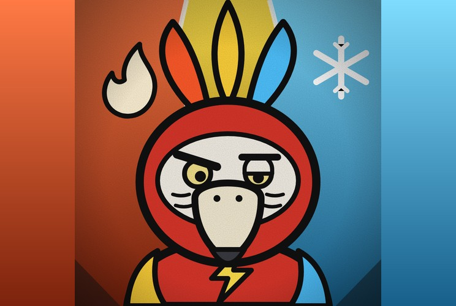

# Arara Tríade

**Elemental Triplo de Grau Especial**

> “Fogo, raio, gelo. Quem sou eu hoje?”

| Lado | Classificação | Função | Série |
|---|---|---|---|
| Vilão | Especial · Fora da Tríade: Grau 1 | Elemental | Temporada 1 |

## Atributos

_Escala de 0 a 5_

| Atributo | Tríade | Uma forma só |
|---|:-:|:-:|
| Força | 4 | 3 |
| Velocidade | 5 | 3 |
| Inteligência | 3 | 2 |
| Resistência | 4 | 3 |
| Energia | 5 | 4 |
| Destruição | 5 | 4 |
| Potencial | 5 | 5 |

## O ciclo

- _Inata_ · **Troca de Personalidade**  
  Alterna sozinho entre três personalidades, cada uma com seu elemento, sempre na ordem fogo, raio, gelo. Ele não escolhe: aparece quem está na vez. Ao trocar, explode no próprio elemento.
- _Depois de um ciclo_ · **Tríade**  
  Depois de passar uma vez por cada elemento em combate, ele concilia os três ao mesmo tempo e alterna livremente os poderes de cada um por um tempo limitado. Depois disso, se esgota e recomeça o ciclo do zero.
- _Reação_ · **Salto de Dor**  
  Se levar dano demais em uma forma, pula para a próxima. Levou dano no fogo, pula o raio e vai direto para o gelo. A forma pulada não conta para o ciclo.

## Fogo · Estressado

- _Personalidade_ · **Fogo**  
  Estressado, ignorante e orgulhoso. Não escuta conselho, acha que sabe tudo e briga por qualquer coisa.
- _Armadura_ · **Armadura de Fogo**  
  Ao transformar, explode em fogo. A armadura só causa dano em quem bater nela de perto, queimando o atacante. Projéteis que possam queimar viram cinzas em um instante ao tocar nela.
- _Campo_ · **Fornalha**  
  Cria um campo de calor em volta dela. Quem estiver dentro sofre dano passivo com o passar do tempo, e quem voa se cansa mais rápido.
- _Ataque comum_ · **Soco Flamejante**  
  Soco com a mão em chamas, que queima no impacto e empurra o alvo.
- _Ataque comum_ · **Rajada de Brasas**  
  Dispara uma chuva de brasas que explodem ao tocar em algo.
- _Ataque comum_ · **Asa em Chamas**  
  Golpe de asa que lança uma onda de fogo em arco à frente.
- _Ultimate_ · **Supernova**  
  Uma bola de fogo enorme que cresce até explodir e varrer tudo ao redor.

## Raio · Ansioso

- _Personalidade_ · **Raio**  
  Ansioso e afobado, fala rápido e às vezes gagueja. Nunca termina a frase antes de agir.
- _Armadura_ · **Armadura de Raio**  
  Ao transformar, explode em choque. A armadura interrompe o ataque de quem bater de perto, e projéteis batem nela e caem no chão.
- _Campo_ · **Tempestade**  
  Invoca uma tempestade que, de vez em quando, solta raios em volta. Serve de antiaéreo: derruba com um raio quem voar.
- _Ataque comum_ · **Faísca Rápida**  
  Descargas curtas e velozes, muito difíceis de desviar.
- _Ataque comum_ · **Cadeia Elétrica**  
  Um raio que pula de um inimigo para outro e atinge todos de uma vez.
- _Ataque comum_ · **Investida Relâmpago**  
  Corre como um raio e acerta o alvo num único flash.
- _Ultimate_ · **Raio-Canhão**  
  Um feixe de raio ultra forte, disparado com as duas mãos depois de uma pose de carga.

## Gelo · Calmo

- _Personalidade_ · **Gelo**  
  Calmo, distante e apático. Fala pouco, reage devagar e parece não se importar.
- _Armadura_ · **Armadura de Gelo**  
  Ao transformar, congela tudo em volta. A armadura congela quem encostar nele. Nada de especial contra projéteis, mas é a armadura mais resistente de todas contra qualquer tipo de dano.
- _Reação_ · **Clone de Gelo**  
  Se estiver rápido o bastante, pula para trás e deixa um clone de gelo no lugar. Quem atacar o clone fica congelado.
- _Campo_ · **Nevasca**  
  Invoca uma nevasca que deixa os inimigos lentos e impede o voo.
- _Ataque comum_ · **Lança Gélida**  
  Arremessa lanças de gelo afiadas, que ficam presas no alvo.
- _Ataque comum_ · **Parede de Gelo**  
  Ergue uma muralha de gelo para bloquear ataques e cortar caminho.
- _Ataque comum_ · **Sopro Glacial**  
  Sopra um cone de frio que congela os pés de quem for atingido.
- _Ultimate_ · **Estaca de Gelo**  
  Uma estaca de gelo enorme que perfura o alvo e congela o que estiver em volta.

## Pontos fracos

- _Limitação_ · **Instável**  
  Muda de forma sozinho e não escolhe quem aparece. Cada personalidade tem seu defeito: o fogo ignora conselho, o raio gagueja e se atrapalha, o gelo demora a reagir.
- _Limitação_ · **Ciclo Previsível**  
  A ordem é sempre fogo, raio, gelo. Quem percebe prepara o contra do elemento seguinte.
- _Fraqueza_ · **Fraqueza por Forma**  
  O fogo cai com água, o raio com isolantes e terra, e o gelo com calor.
- _Custo_ · **Tríade Esgota**  
  Depois da Tríade, fica esgotado e indefeso por um tempo, e recomeça o ciclo do zero.
- _Limitação_ · **Dano Atrasa o Ciclo**  
  Dano demais pula uma forma, e a pulada não conta. A Tríade demora mais para chegar.
