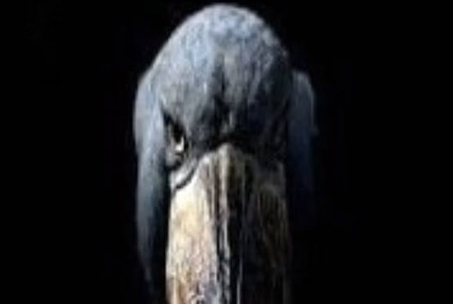
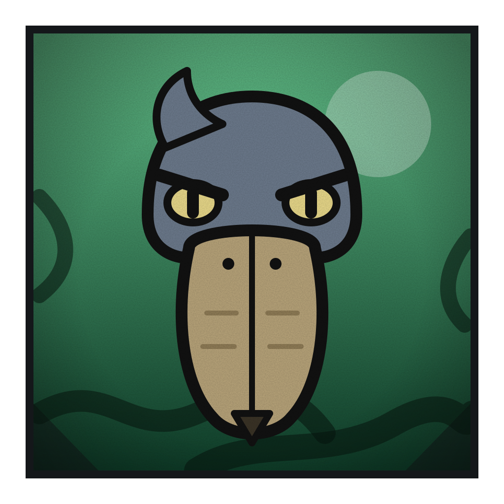

# Bico Sombrio

**Mestre das Ilusões de Grau 1**

 

> “Estou rindo?”

| Classificação | Função | Série |
|---|---|---|
| Grau 1 · Quem o encara já está dentro | Assassino | Temporada 1 |

## Atributos

_Escala de 0 a 5_

| Atributo | Valor |
|---|:-:|
| Força | 2 |
| Velocidade | 5 |
| Inteligência | 5 |
| Resistência | 2 |
| Energia | 4 |
| Destruição | 3 |
| Potencial | 4 |

## Técnicas

- _Inata_ · **Ilusão Sombria**  
  Cria ilusões de visão, som, toque e dor que a vítima não distingue da realidade. O corpo reage como se fosse verdade.
- _Gatilho_ · **Olhar Sem Riso**  
  Quem cruza o olhar com ele por um instante já está dentro da ilusão. Ele nunca pisca nem sorri, e é por isso que o olhar pega.
- _Ataque_ · **Pesadelo Sob Medida**  
  Mostra à vítima o pior medo dela. O dano mental é real e pode paralisar, desmaiar ou até parar o coração.
- _Engano_ · **Mil Sombras**  
  Espalha cópias dele pelo campo, com som, cheiro e sombra. O inimigo não sabe qual é a verdadeira.
- _Movimento_ · **Voo de Sombra**  
  Vira sombra e sai voando em velocidade enorme, como um comensal da morte. Passa por frestas e não leva golpe físico, mas só ataca depois de se solidificar.
- _Domínio de expansão_ · **Noite Sem Amanhecer**  
  Uma noite sem fim em que tudo é ilusão e nada se distingue do real. As ilusões sempre acertam, e ele pode estar em qualquer lugar. Só termina quando a vítima aceita que não há saída.

## Pontos fracos

- _Limitação_ · **Cara Séria**  
  Se ele ri ou perde a compostura, as ilusões se desfazem. Uma piada boa demais o desarma.
- _Fraqueza_ · **Luz Forte**  
  A forma de sombra se desfaz na luz forte, e as ilusões ficam mais fracas com flash, fogo ou sol.
- _Fraqueza_ · **Dor Desfaz**  
  Dor real e forte quebra a ilusão. Quem se fere de propósito acorda.
- _Fraqueza_ · **Olhos Fechados**  
  Cego, de olhos fechados ou sem depender da visão, o alvo escapa das ilusões visuais. Só restam as de som e toque.
- _Custo_ · **Ilusão Cobra Energia**  
  Manter muitas ilusões ou ilusões longas gasta a energia dele. Lutas longas o deixam parado.
- _Limitação_ · **Corpo Sólido Frágil**  
  Ao se solidificar para atacar, fica pouco resistente. Um golpe que acerta pesa muito.
