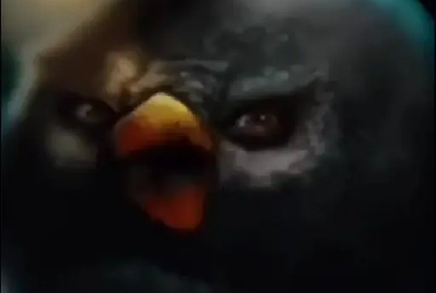
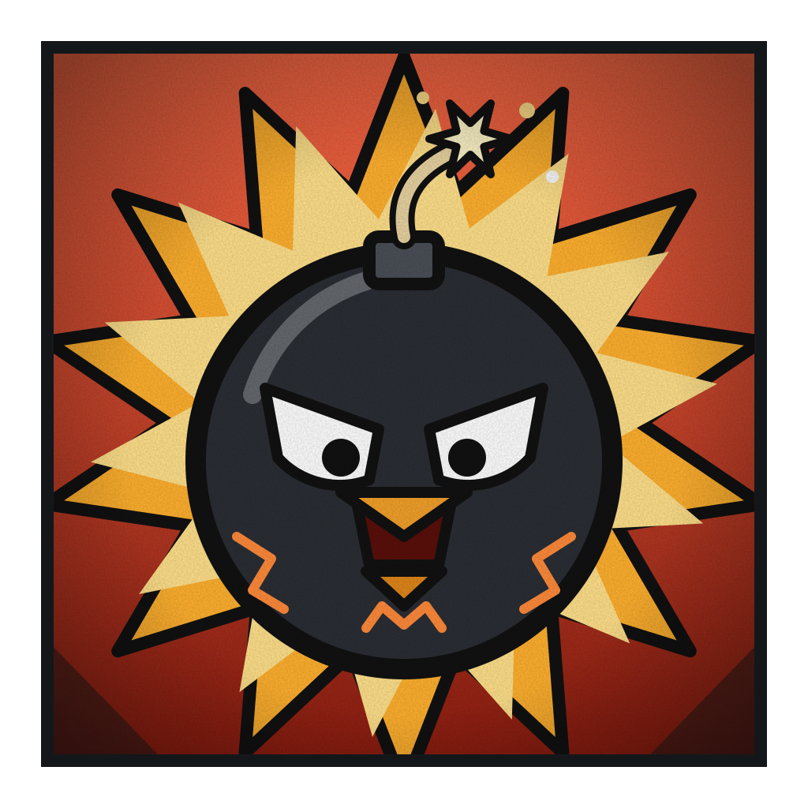

# Bomba

**Tanque Explosivo de Grau 1**

 

> “Pode bater. Eu devolvo com juros.”

| Classificação | Função | Série |
|---|---|---|
| Grau 1 · Mais perigoso quanto mais apanha | Linha de frente | Temporada 1 |

## Atributos

_Escala de 0 a 5_

| Atributo | Valor |
|---|:-:|
| Força | 4 |
| Velocidade | 2 |
| Inteligência | 2 |
| Resistência | 5 |
| Energia | 4 |
| Destruição | 5 |
| Potencial | 3 |

## Técnicas

- _Passiva_ · **Pavio Curto**  
  Cada golpe que ele leva e cada vez que se irrita enche a Carga. Quanto mais Carga, mais forte é qualquer explosão dele. Quem bate nele alimenta a própria derrota.
- _Defesa_ · **Casca Chamuscada**  
  Pele e penas queimadas e grossas. Aguenta explosões, inclusive as próprias, e quase nada o atravessa.
- _Área_ · **Estouro**  
  Detona o próprio corpo em uma onda de choque em volta de si. Afasta quem está colado nele e causa dano em área.
- _Projétil_ · **Ovo-Granada**  
  Bota um ovo que explode ao tocar em algo ou após uma contagem curta. Pode ser arremessado ou deixado no chão como mina.
- _Controle_ · **Pavio Marcado**  
  Acende um pavio no alvo com um toque ou um ovo. Detona quando quiser, ou sozinho se a Carga passar do limite. Dá para marcar vários e explodir em cadeia.
- _Golpe final_ · **Cabeça-Bomba**  
  Gasta a Carga inteira em um único soco ou cabeçada explosiva. É o maior dano dele e o deixa vazio por alguns segundos.
- _Domínio de expansão_ · **Campo Minado do Pavio Sem Fim**  
  Tudo dentro ganha um pavio: chão, paredes, ar e o corpo do inimigo. Todo movimento acende uma explosão que não dá para desviar. Há uma contagem regressiva visível, que cai mais rápido quanto mais o inimigo se mexe. No zero, uma detonação gigante acerta todos, inclusive o Bomba.

## Pontos fracos

- _Limitação_ · **Pavio Curto Demais**  
  Muito irritado, perde o controle e as explosões saem em qualquer direção, até contra os aliados.
- _Fraqueza_ · **Pavio Molhado**  
  Água, frio e qualquer coisa que apague o pavio enfraquecem as explosões dele.
- _Limitação_ · **Lento e Pesado**  
  Fácil de acertar de longe. Quem mantém distância e não se aproxima sofre menos.
- _Custo_ · **Vazio Pós-Estouro**  
  Depois da Cabeça-Bomba ou do domínio, fica sem Carga e sem força até recarregar.
- _Limitação_ · **Fumaça**  
  As explosões enchem o ambiente de fumaça e atrapalham a visão dele também. Lutas longas o deixam meio cego.
- _Fraqueza_ · **Sem Carga, Sem Bomba**  
  Se ninguém o atinge e ele fica calmo, o poder cai bastante. Inimigos espertos evitam bater nele.
