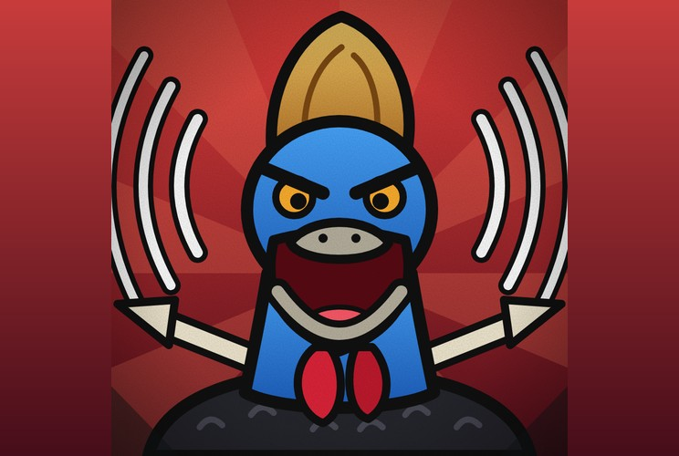

# Casuar de Ataque

**Brutamontes do Grito de Grau 1**

> “Ataque!”

| Lado | Classificação | Função | Série |
|---|---|---|---|
| Herói | Grau 1 | Ataque | Temporada 1 |

## Atributos

_Escala de 0 a 5_

| Atributo | Fúria cheia | Sem fúria |
|---|:-:|:-:|
| Força | 5 | 4 |
| Velocidade | 3 | 3 |
| Inteligência | 3 | 3 |
| Resistência | 4 | 3 |
| Energia | 3 | 3 |
| Destruição | 4 | 3 |
| Potencial | 4 | 4 |

## Fúria

- _Inata_ · **Fúria**  
  Medidor com 3 níveis. Enche quando ele bate em inimigos ou nas técnicas deles: paredes, escudos, monstros evocados e o que mais o inimigo criar.
- _Regra_ · **Gastar Níveis**  
  Ele escolhe gastar 1, 2 ou 3 níveis de uma vez, e o grito sai na força do que foi gasto.
- _Técnica_ · **Punhos de Cristal**  
  Cristaliza punhos e pés: cada golpe causa dano crítico, 100% das vezes. Enquanto estiver cristalizado, a fúria máxima cai para o nível 2.

## Grito

- _Nível 1_ · **Grito Curto**  
  Recupera só o que foi ferido há poucos segundos e atordoa o oponente de leve, tudo no mesmo grito, sem causar dano.
- _Nível 2_ · **Grito Forte**  
  Recupera a vida perdida, e o que sobrar vira bônus temporário de vida acima do limite. Atordoa os inimigos de forma média, derruba quem estiver voando, causa dano e ele ignora a dor, sem ser interrompido.
- _Nível 3_ · **Grito Total**  
  Recupera toda a vida e dá bônus de vida. Derruba o voo, causa surdez temporária e desorientação pesada nos inimigos, e ele ignora a dor.

## Combate

- _Técnica_ · **Lança de Osso**  
  Cria uma lança de osso do próprio corpo e arremessa de longe. Gasta vida, que pode ser recuperada com o grito.
- _Mobilidade_ · **Salto Grande**  
  Não voa. Em vez disso, dá saltos enormes para chegar no alvo ou escapar.
- _Inata_ · **Só Diz “Ataque”**  
  Por algum motivo, só consegue falar essa palavra. Ele entende tudo e pensa normalmente, só não consegue se expressar.

## Pontos fracos

- _Limitação_ · **Sem Voo**  
  Não alcança quem está no ar. Só os saltos e as lanças de osso chegam lá.
- _Limitação_ · **Fúria Depende de Bater**  
  Se ficar longe ou não tiver o que bater, a fúria não enche. Sem fúria, ele é só um bruto sem grito.
- _Limitação_ · **Cura Tem Janela**  
  No nível 1 só recupera o que foi ferido há poucos segundos. Ferida antiga só se cura com mais níveis.
- _Custo_ · **Cristal Limita a Fúria**  
  Com os punhos cristalizados, a fúria máxima cai para o nível 2 e o Grito Total fica fora de alcance.
- _Custo_ · **Lança Cobra Vida**  
  Cada lança de osso arremessada gasta vida dele. Se estiver sem fúria, não tem como recuperar.
- _Limitação_ · **Não Consegue Se Comunicar**  
  Só diz “Ataque”, então não explica planos nem pede ajuda. Aliados precisam adivinhar o que ele quer.
