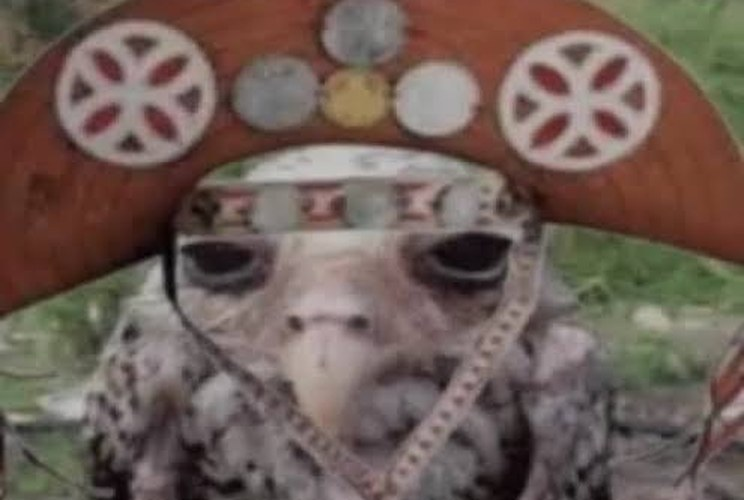
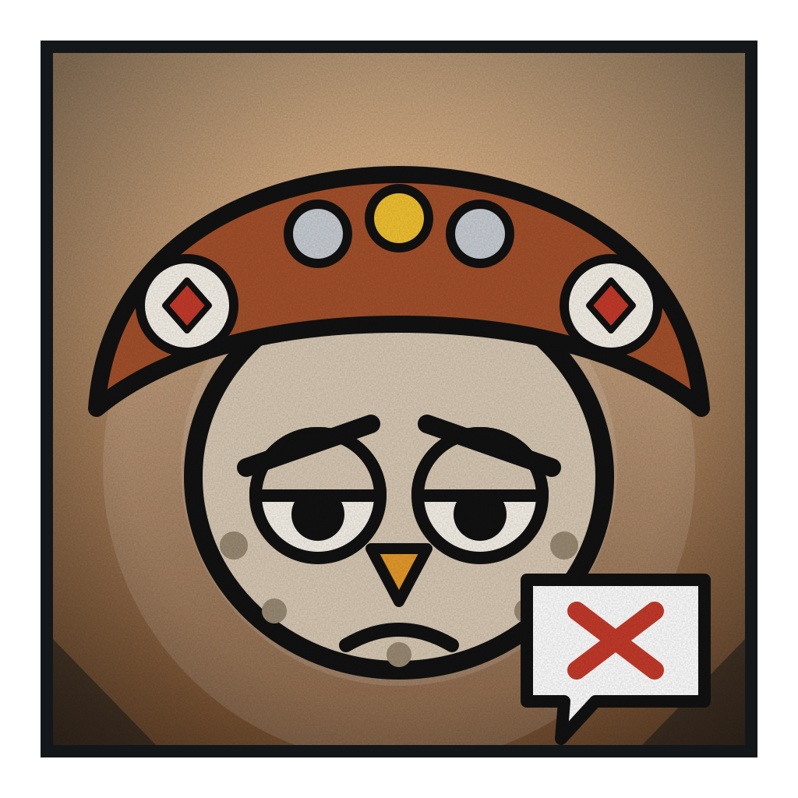

# Coruja Pessimista

**Voz Amaldiçoada de Grau 1**

 

> “Vai dar errado. Sempre dá.”

| Classificação | Função | Série |
|---|---|---|
| Grau 1 · Cada palavra dele vale como ordem | Controlador | Temporada 1 |

## Atributos

_Escala de 0 a 5_

| Atributo | Valor |
|---|:-:|
| Força | 1 |
| Velocidade | 2 |
| Inteligência | 3 |
| Resistência | 1 |
| Energia | 4 |
| Destruição | 4 |
| Potencial | 4 |

## Técnicas

- _Inata_ · **Fala Amaldiçoada**  
  Tudo o que ele diz vira ordem e muda as ações ou o estado de quem ouve. Alvo mais forte resiste mais, e cada ordem cobra a garganta dele.
- _Ordem curta_ · **Murmúrio**  
  Ordens de uma palavra, como "pare", "caia" ou "durma". Baratas e rápidas, mas fracas contra quem é forte.
- _Ordem longa_ · **Sentença**  
  Ordens completas que mudam o estado do alvo, como cegar, pesar, esquecer ou paralisar. Muito mais forte que o Murmúrio e machuca a garganta dele.
- _Praga_ · **Vai Dar Errado**  
  Ele reclama que vai dar errado e a próxima ação do alvo falha: o golpe erra, o pulo tropeça, a técnica falha. É a praga favorita dele, porque é a que ele mais acredita.
- _Ritual_ · **Chapéu Calmante**  
  Usar um chapéu o acalma e o impede de falar sem querer. De chapéu, as ordens só saem quando ele decide. Sem um, ele solta asneira e fere os amigos.
- _Domínio de expansão_ · **Última Reclamação**  
  Dentro, ninguém resiste a ele, nem o mais forte. Ele dá até três ordens que o alvo obedece sem escolha, sem desvio e sem defesa. Cada ordem gasta a voz dele, e depois da terceira ele fica mudo por muito tempo.

## Pontos fracos

- _Custo_ · **Garganta Frágil**  
  Cada ordem forte machuca a garganta. Depois de várias, a voz falha e as ordens enfraquecem ou param.
- _Limitação_ · **Sem Chapéu**  
  Sem um chapéu, perde o controle e solta asneiras que viram ordem contra os próprios aliados.
- _Limitação_ · **Palavra que Volta**  
  Quando se queixa de si mesmo, como "sou inútil", a ordem pode cair nele próprio.
- _Fraqueza_ · **Não Ouviu, Não Obedece**  
  A ordem só vale para quem ouve. Tampão de ouvido, surdez, barulho alto ou silêncio total anulam a fala.
- _Fraqueza_ · **Gente Forte Resiste**  
  Quanto maior a energia do alvo, mais ele resiste. Os muito fortes ignoram o Murmúrio.
- _Limitação_ · **Crise de Sentido**  
  Procura sentido na vida e duvida de si. Quando hesita, a voz treme e a ordem sai fraca.
- _Limitação_ · **Corpo Mínimo**  
  Pequeno e frágil. Não corre nem aguenta apanhar.
