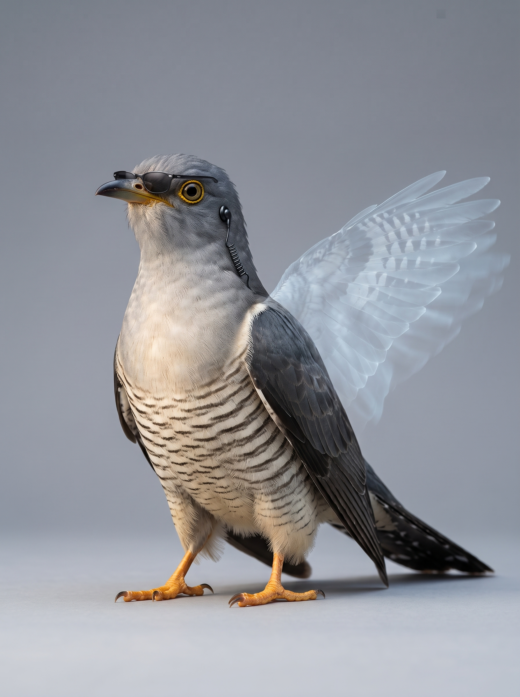
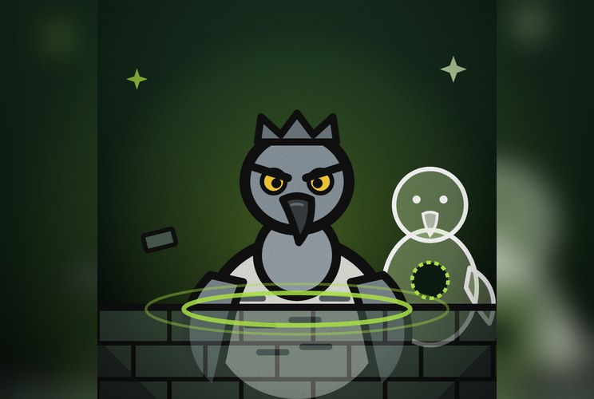

# Cuco Intruso

**Infiltração · Corpo Poroso**

 

> “A parede é só uma sugestão.”

| Lado | Classificação | Função | Série |
|---|---|---|---|
| — | Grau 2 · Dentro da parede: Grau 1 | Infiltrado · Lado a definir | Temporada 1 |

## Atributos

_Escala de 0 a 5, por postura_

| Atributo | Sólido ★ | Poroso | Mergulhado | Com o Oco |
|---|:-:|:-:|:-:|:-:|
| Força | 2 | 1 | 1 | 3 |
| Velocidade | 4 | 4 | 3 | 4 |
| Inteligência | 4 | 4 | 5 | 4 |
| Resistência | 1 | 5 | 4 | 1 |
| Energia | 3 | 3 | 3 | 2 |
| Destruição | 2 | 1 | 1 | 3 |
| Potencial | 4 | 4 | 4 | 4 |

- **Sólido**: Sólido
- **Poroso**: Poroso
- **Mergulhado**: Mergulhado
- **Com o Oco**: Com o Oco

## Quem ele é

- _Inata_ · **Parasita de Ninhos**  
  Vive entrando onde não foi chamado. Cresceu enganando ninhos alheios, e hoje o Conselho o usa para entrar onde ninguém consegue.
- _Inata_ · **Olho de Cuco**  
  Guarda a planta de cada lugar por onde passou: portas, vigias, vãos e rotas de fuga. Quase nunca se perde.
- _Técnica_ · **Passo Leve**  
  Pousa e anda sem fazer barulho, sem arrastar pena no chão.

## Corpo Poroso

- _Técnica_ · **Corpo Poroso**  
  Deixa o corpo atravessar sólidos: paredes, portas, chão e teto. Enquanto está poroso, nada o toca, mas ele também não toca em nada.
- _Técnica_ · **Atravessar Pássaros**  
  Passa por dentro do corpo de outros pássaros, como quem atravessa uma cortina fria. Quem é atravessado sente um arrepio e perde o fôlego por um instante, mas não se fere.
- _Técnica_ · **Fase Parcial**  
  Deixa só uma asa ou um pé porosos, para pegar o que está dentro de um cofre ou de uma parede sem atravessar o corpo todo.
- _Técnica_ · **Mergulho**  
  Afunda no chão ou na parede como na água, e anda lá dentro na velocidade de uma caminhada. Só consegue ver e ouvir bem de perto.

## Stand: Cuco Oco

- _Técnica_ · **Cuco Oco**  
  Um gêmeo fantasma e oco, com um buraco redondo no peito. Entra em parede, chão e pássaro, e vê o que ele vê. Alcance curto.
- _Técnica_ · **Olhos Dentro da Parede**  
  Manda o Oco na frente enquanto o corpo fica parado do lado de fora. Dá para olhar uma sala inteira sem entrar nela.
- _Técnica_ · **Esconderijo Interno**  
  O Oco guarda objetos dentro de paredes, do chão ou de um pássaro, sem machucar. O item fica preso ali até ele puxar de volta.
- _Técnica_ · **Marca por Dentro**  
  Planta uma etiqueta pequena dentro do corpo de um pássaro. Ele sente onde a etiqueta está, até de longe, até ser tirada.
- _Técnica_ · **Asa que Entra**  
  A asa do Oco entra no corpo do alvo e aperta uma junta por dentro. A asa ou a perna do alvo fica dormente por alguns segundos.

## Pontos fracos

- _Fraqueza_ · **Frágil Quando Sólido**  
  Fora da fase, ele tem quase nenhuma resistência. Um golpe direto o derruba.
- _Fraqueza_ · **Preso na Parede**  
  Se for interrompido ou ficar sem energia no meio de um sólido, ele volta sólido lá dentro e se fere muito. É o maior risco dele.
- _Limitação_ · **Energia Barra o Caminho**  
  Não atravessa barreiras de energia nem pássaros com muito mais energia que ele. Domínios o prendem.
- _Limitação_ · **Eco Denuncia**  
  Quem usa ecolocalização, como o Morcego e o Escutador, sente a massa dele dentro da parede.
- _Limitação_ · **Pouca Carga**  
  Só leva consigo o que cabe no bico ou na bolsa do corpo, e nada grande. O resto fica para trás.
- _Limitação_ · **Poroso Não Ataca**  
  Para golpear, ele precisa ficar sólido, e fica exposto nesse instante. Atravessar é rápido, mas lutar é arriscado.
- _Limitação_ · **Atravessar Cansa**  
  Quanto mais grosso o sólido e quanto mais tempo poroso, mais energia gasta.
- _Limitação_ · **Dano Compartilhado**  
  O que atinge o Oco também o machuca. Dentro de um pássaro, o Oco fica vulnerável a ele.
