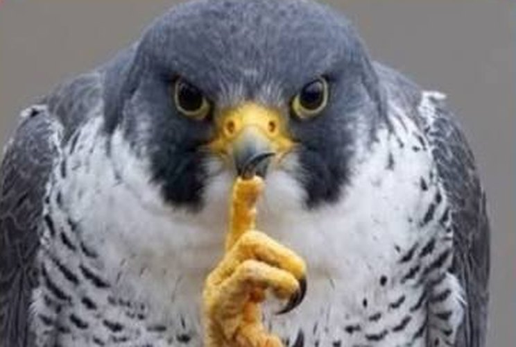
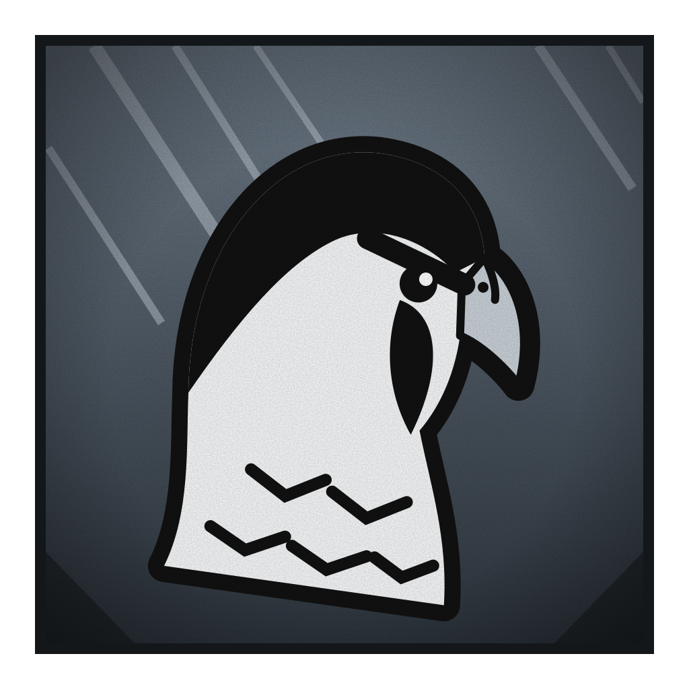

# Falcão Peregrino

**Caçador Sem Dom de Grau 1**

 

> “Dom é desculpa. Eu treinei.”

| Classificação | Função | Série |
|---|---|---|
| Grau 1 · Sem energia: ninguém o mede | Rival | Temporada 1 |

## Atributos

_Escala de 0 a 5_

| Atributo | Valor |
|---|:-:|
| Força | 5 |
| Velocidade | 5 |
| Inteligência | 3 |
| Resistência | 4 |
| Energia | 0 |
| Destruição | 4 |
| Potencial | 3 |

## Técnicas

- _Inata_ · **Corpo Sem Dom**  
  Nasceu sem energia nenhuma, e o corpo compensou: força, reflexos, resistência e sentidos no limite. Quem rastreia por energia não o acha.
- _Passiva_ · **Resistência Elemental**  
  Resiste a fogo, raio, gelo, veneno e doença, e aguenta temperaturas extremas, de frio polar a calor de forno, sem perder força nem velocidade. É por isso que usa fogo e gelo no próprio corpo sem se machucar.
- _Golpe_ · **Mergulho Peregrino**  
  Sobe e cai em linha reta. Quanto maior a altura, mais velocidade e mais dano. É o golpe mais rápido da série.
- _Treino_ · **Visão Treinada**  
  Não tem os olhos do irmão. Treinou a vista até enxergar quase tanto, no braço e sem dom.
- _Domínio de expansão_ · **Céu do Caçador**  
  Sem energia, ele paga com um voto: sacrifica uma arma do arsenal, à escolha dele, que quebra de vez e não volta mais. O chão some e o inimigo cai em um céu sem fim, aberto e sem paredes. Dentro, o Mergulho Peregrino sempre acerta, sem desvio e sem defesa, e ele tem altura de sobra. Termina depois de três mergulhos e o deixa exausto.

## Arsenal de mercenário

- _Pistola_ · **Canela Seca**  
  Uma pistola normal, sem maldição. Força o inimigo a desviar, atrapalha e acerta quem não aguenta bala.
- _Bastão que muda de tamanho_ · **Jingubang**  
  Um bastão que altera o tamanho: estica, encolhe e cresce até virar lança, barreira, ponte ou alavanca. Dá alcance e serve para prender e empurrar.
- _Nunchaku de gelo e choque_ · **Cérberus Gêmeos**  
  Um nunchaku de gelo e choque: uma ponta congela e a outra dá choque. O gelo trava, o choque atordoa, e juntos derrubam quase qualquer um.
- _Luvas e botas de fogo_ · **Balrog**  
  Um par de luvas e botas que pegam fogo quando golpeiam o inimigo e se apagam quando ele para de bater. Quanto mais seguido o combo, mais forte o fogo.
- _Bazuca_ · **Belezona**  
  Uma bazuca. Dano alto em área, com poucos tiros e recarga demorada.
- _Ferramenta amaldiçoada_ · **Garra Quebra-Regra**  
  Anula técnicas e regras no ponto onde corta. É a única coisa que fura a Disciplina da Águia. Só existe uma, e ele precisa tocar a barreira.

## Pontos fracos

- _Limitação_ · **Inveja do Irmão**  
  Diante da Águia luta com raiva e comete erros que não cometeria com outro.
- _Limitação_ · **Orgulho**  
  Recusa ajuda, não faz plano em grupo e prefere perder sozinho.
- _Fraqueza_ · **Dependência de Ferramentas**  
  Sem o arsenal só sobra o corpo. Sem a Garra Quebra-Regra, não fura a Disciplina.
- _Limitação_ · **Fogo Depende do Ritmo**  
  Se parar de bater por um instante, as luvas e botas se apagam. Quem o faz errar o ritmo o desarma.
- _Limitação_ · **Mergulho Sem Curva**  
  Cai em linha reta e não muda a rota no ar. Quem sai da frente na hora certa o deixa exposto, e em lugar fechado ou sem altura o golpe nem funciona.
- _Fraqueza_ · **Sem Cura**  
  Não se cura nem reverte ferida com técnica. Cada dano que leva fica, e lutas longas o desgastam.
- _Fraqueza_ · **Sem Defesa Contra Energia**  
  Aguenta o impacto, mas ataques de técnica atravessam sem nada que os desvie.
