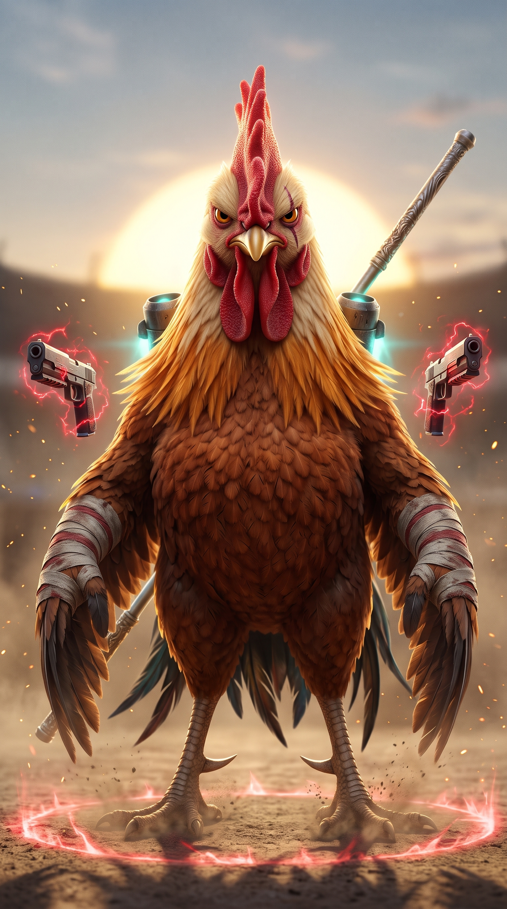
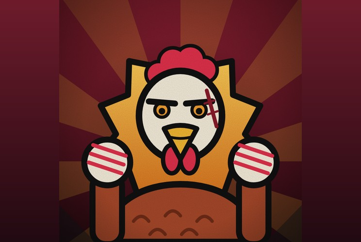

# Galo Ultra Inabalável

**Mestre do Corpo a Corpo de Grau 1**

 

> “Não saio do lugar.”

| Lado | Classificação | Função | Série |
|---|---|---|---|
| Neutro | Grau 1 | Corpo a corpo | Temporada 1 |

## Atributos

_Escala de 0 a 5, por postura_

| Atributo | Sem postura | Calau ★ | Garça | Beija-flor | Pinguim-Imperador | Inabalável |
|---|:-:|:-:|:-:|:-:|:-:|:-:|
| Força | 3 | 5 | 3 | 3 | 3 | 5 |
| Velocidade | 3 | 3 | 4 | 5 | 2 | 5 |
| Inteligência | 3 | 3 | 3 | 3 | 3 | 3 |
| Resistência | 4 | 4 | 3 | 2 | 5 | 5 |
| Energia | 3 | 3 | 4 | 3 | 3 | 4 |
| Destruição | 2 | 4 | 3 | 2 | 3 | 5 |
| Potencial | 4 | 4 | 4 | 4 | 4 | 4 |

- **Sem postura**: Sem postura
- **Calau**: Cabeça-Dura como Calau
- **Garça**: Certeiro como Garça
- **Beija-flor**: Leve como Beija-flor
- **Pinguim-Imperador**: Firme como Pinguim-Imperador
- **Inabalável**: Inabalável como um Galo

## Base

- _Inata_ · **Inabalável**  
  Não se abala. Golpes fracos não o empurram, não o atordoam e não o fazem recuar. Só ataques realmente fortes conseguem tirar o equilíbrio dele.
- _Inata_ · **Esporão**  
  Esporões duros nas pernas, que cortam como lâminas. Entram em todos os chutes e golpes baixos.
- _Técnica_ · **Quatro Posturas**  
  Luta em quatro estilos, cada um com nome de ave. Troca de postura a qualquer instante, mesmo no meio de um golpe, sem custo. Cada postura libera as próprias técnicas: ele só usa os golpes e as armas da postura em que está, exceto na Inabalável como um Galo.
- _Regra_ · **Ódio**  
  Ao levar uma certa quantidade de dano, o ódio sobe, até o nível 4. Do 1 ao 3, quanto mais ódio, mais dano ele causa, mas menos velocidade e precisão ele tem. O nível 4 não dá vantagem extra em relação ao 3: ele dispara a Inabalável como um Galo.
- _Técnica_ · **Bufada**  
  Solta uma bufada que baixa o ódio e devolve a velocidade. A primeira zera o ódio, e cada bufada seguinte reduz menos que a anterior.
- _Postura final_ · **Inabalável como um Galo**  
  Ao chegar no ódio 4, libera uma onda de choque em volta e entra nessa postura. Usa tudo o que as quatro posturas oferecem, causa 20% a mais de dano, resiste a ataques pesados sem ser empurrado e fica mais rápido. Durante ela, o ódio fica em 0, e volta a 0 quando ela acaba. Dura pouco tempo, e ao terminar o GUI fica cansado.
- _Equipamento_ · **Mochila de Pulo**  
  Ele normalmente não voa. O Pinguim Lenda deu a ele uma mochila de pulo, que dá saltos longos e impulsos curtos no ar. Não substitui o voo.

## Porrada · Cabeça-Dura como Calau

- _Postura_ · **Cabeça-Dura como Calau**  
  A postura da porrada. Ele cola no inimigo e bate sem parar. Nela ficam liberados os golpes especiais do estilo e as armas de porrada: a Marreta do Herói e a Marreta Qing.
- _Golpe_ · **Cabeçada de Calau**  
  Cabeçada que quebra a guarda do alvo e o deixa aberto por um instante.
- _Golpe_ · **Ombrada de Albatroz**  
  Investida de ombro que empurra o inimigo e o prensa na parede ou no chão.
- _Golpe_ · **Gancho de Bico**  
  Soco de baixo para cima que lança o alvo ao ar e abre espaço para o combo.
- _Arma_ · **Marreta do Herói**  
  Marreta enorme. É lenta, mas dá muito dano, e quanto mais alto ele estiver ao bater, maior o dano e a onda de choque. Combina com a Mochila de Pulo.
- _Especial_ · **Queda do Herói**  
  Sobe alto com a mochila e despenca com a Marreta. O dano e o tamanho da onda de choque crescem com a altura da queda.
- _Especial_ · **Pancada Rachadura**  
  Marretada no chão que abre uma rachadura em linha reta. Quem estiver no caminho é lançado para cima pela onda de choque.
- _Arma_ · **Marreta Qing**  
  Bastão versátil e rápido, que não estica. Serve para atacar, bloquear e manter distância. Ao girar, bloqueia projéteis, e pode dar Counter.
- _Especial_ · **Giro de Hélice**  
  Gira a Marreta Qing na frente do corpo, bloqueando projéteis, e avança varrendo quem estiver no caminho.
- _Especial_ · **Counter**  
  Devolve o golpe do inimigo no instante certo. Ele fica invulnerável por alguns instantes, mas o ódio sobe rápido.
- _Especial_ · **Chuva de Bastão**  
  Sequência de estocadas muito rápidas, que acertam o alvo dezenas de vezes em poucos segundos.
- _Especial_ · **Salto de Vara**  
  Finca o bastão no chão, se lança no ar com a mochila e cai sobre o alvo com uma pancada vinda de cima.

## Longo alcance · Certeiro como Garça

- _Postura_ · **Certeiro como Garça**  
  A postura da distância. Libera as armas de longe e os golpes de alcance longo, para acertar de fora do alcance do inimigo.
- _Arma_ · **Confiáveis**  
  Par de pistolas que disparam energia amaldiçoada. Tiros rápidos em sequência, bons para pressionar sem parar de se mexer.
- _Arma_ · **Belezinha**  
  Pistola que lança uma pequena carga explosiva. Explode ao contato e acerta quem estiver em volta.
- _Golpe_ · **Estocada de Garça**  
  Avanço do pescoço e da bicada, rápido como um bote, que acerta antes de o alvo reagir.
- _Golpe_ · **Esporão Voador**  
  Chute com salto, de esporão para frente, que cobre uma grande distância.
- _Golpe_ · **Varredura de Pernalta**  
  Rasteira longa, que derruba quem estiver correndo na direção dele.

## Esquiva · Leve como Beija-flor

- _Postura_ · **Leve como Beija-flor**  
  A postura da esquiva. Ele paira, desliza e muda de direção sem aviso, e quase nada o acerta.
- _Técnica_ · **Zumbido**  
  Esquiva rápida, em microdesvios em sequência. A cada golpe esquivado, ele fica um pouco mais rápido, por pouco tempo.
- _Técnica_ · **Rastro de Beija-flor**  
  Se a esquiva for perfeita, deixa um clone ilusório no lugar por 1 segundo. O inimigo ataca o clone.
- _Técnica_ · **Pairar**  
  Salta sobre o ataque do inimigo e contra-ataca de cima, no ponto cego.
- _Técnica_ · **Pé de Vento**  
  Passo rápido que atravessa a guarda do inimigo e o deixa de costas para ele.

## Bloqueio · Firme como Pinguim-Imperador

- _Postura_ · **Firme como Pinguim-Imperador**  
  A postura da defesa. Ele fecha a guarda e aguenta tudo, juntando nível de bloqueio para devolver.
- _Técnica_ · **Muralha de Penas**  
  Bloqueia e reduz o dano. Cada bloqueio dá um pouco de nível de bloqueio. Ele não sai do lugar enquanto segura.
- _Técnica_ · **Giro de Bastão**  
  Também nesta postura, ele pode girar a Marreta Qing para bloquear projéteis, sem sair do lugar.
- _Técnica_ · **Asa-Espelho**  
  Bloqueio perfeito: apara no instante certo, não leva dano e ganha mais nível de bloqueio. Pode contra-atacar na mesma hora.
- _Regra_ · **Nível de Bloqueio**  
  Vai de 0 a 10 níveis, guardados como cargas. Quanto mais nível, maior o dano da Devolução.
- _Técnica_ · **Devolução**  
  Libera todas as cargas de uma vez, em um só golpe, e o dano cresce com o nível. Se for liberada logo em um bloqueio perfeito, causa o dobro do dano.
- _Técnica_ · **Bola de Penas**  
  Se enrola e rola como uma bola, absorvendo o impacto, e dispara contra o alvo como um aríete.

## Pontos fracos

- _Custo_ · **Counter Acende o Ódio**  
  Cada Counter dá invulnerabilidade curta, mas sobe o ódio rápido. Usar demais o leva ao ódio 4 e ao cansaço depois.
- _Limitação_ · **Marreta Pesada**  
  A Marreta é lenta. Quem desvia no tempo certo o pune, e com ódio alto, que reduz a precisão, ele erra mais ainda.
- _Limitação_ · **Ódio Cego**  
  Com muito ódio, perde velocidade e precisão. Quem o faz levar dano e o provoca o deixa lento e errando golpes.
- _Custo_ · **Cansaço Pós-Galo**  
  Quando a Inabalável como um Galo acaba, o GUI fica cansado e vulnerável por um tempo. Quem aguenta até lá o pega no pior momento.
- _Limitação_ · **Só Perto ou Pistola**  
  Fora da postura de longe, só alcança com o corpo. Contra quem voa alto, depende da mochila de pulo, que dá só impulsos curtos.
- _Fraqueza_ · **Furo de Cada Postura**  
  O Calau é lento para desviar, a Garça é fraca de perto, o Beija-flor bate pouco e o Pinguim-Imperador fica parado.
- _Limitação_ · **Perfeito Exige Timing**  
  A esquiva e o bloqueio perfeitos dependem de acertar o tempo. Contra golpes imprevisíveis, ele erra e leva o dano cheio.
- _Fraqueza_ · **Teimoso**  
  Não recua nunca, mesmo quando devia. Cai em provocação e em armadilha de quem o conhece.
