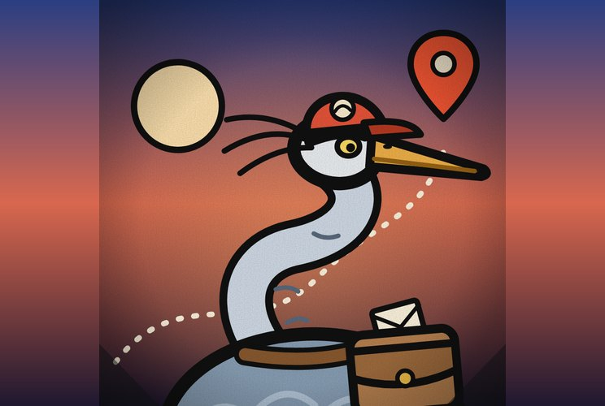

# Garça Entregadora

**Entregador Neutro, Pontual e Sigiloso**

> “Entrego em qualquer endereço. Não pergunto o que tem dentro.”

| Lado | Classificação | Função | Série |
|---|---|---|---|
| Neutro | Grau 2 · Logística: Grau 1 | Neutro · Serviço de Entrega | Temporada 1 |

## Atributos

_Escala de 0 a 5, por postura_

| Atributo | Normal ★ | Entrega Expressa | Carro-Forte |
|---|:-:|:-:|:-:|
| Força | 1 | 1 | 1 |
| Velocidade | 4 | 5 | 1 |
| Inteligência | 4 | 4 | 4 |
| Resistência | 2 | 1 | 5 |
| Energia | 4 | 4 | 4 |
| Destruição | 1 | 1 | 1 |
| Potencial | 4 | 4 | 4 |

- **Normal**: Normal
- **Entrega Expressa**: Entrega Expressa
- **Carro-Forte**: Carro-Forte

## Quem ele é

- _Inata_ · **Entregador de Ofício**  
  Vive de entregar e coletar itens para quem pagar, herói ou vilão. É neutro por profissão: o endereço só precisa ser válido.
- _Inata_ · **Sigiloso**  
  Nunca abre o pacote e nunca conta quem pediu a entrega. Ninguém arranca dele o nome de um cliente.
- _Inata_ · **Pontual**  
  Tem o prazo na cabeça o tempo todo e cumpre mesmo sob pressão. Atraso é o que mais o incomoda.

## Logística

- _Técnica_ · **Bolsa Sem Fundo**  
  Bolsa amaldiçoada com espaço enorme por dentro. Guarda armas, comida, remédios e cargas grandes, e o peso não o atrapalha. Tem limite de espaço e gasta energia conforme enche.
- _Técnica_ · **Endereço**  
  Marca um destinatário ou um local que já viu ou cuja energia conhece, e a marca o guia até lá pela Rota Perfeita. Ele entrega pessoalmente: tem que chegar ao destino, não entrega de longe. Só itens, não pessoas.
- _Técnica_ · **Coleta**  
  Puxa para a bolsa um item ao alcance dele, desde que esteja largado, perdido ou liberado pelo dono. Não arranca da asa de quem o segura firme.
- _Técnica_ · **Rota Perfeita**  
  Sente o caminho mais rápido entre dois pontos, com atalhos, correntes de vento, perigos e obstáculos. Voa longe com carga sem se perder e sem esbarrar.

## Tipos de entrega

- _Modalidade_ · **Entrega Comum**  
  O serviço padrão. Voa na velocidade normal e leva várias cargas comuns na mesma viagem.
- _Modalidade_ · **Entrega Expressa**  
  Só ativa enquanto ele faz uma entrega expressa contratada. O voo mais veloz da série inteira, com a velocidade máxima mais alta de todos os personagens. Fora da entrega expressa, voa na velocidade normal.
- _Modalidade_ · **Carro-Forte**  
  Quando o cliente escolhe, e enquanto faz a rota dessa entrega, ele fica blindado, com a maior resistência dele. O preço é voar na velocidade 1.
- _Serviço pago_ · **Seguro**  
  Se o cliente pagar, e a carga da entrega for perdida ou danificada, ela some e aparece uma cópia idêntica no lugar onde ele pegou o pacote. Ele precisa voltar lá para recuperá-la.
- _Serviço pago_ · **Rastreio**  
  Se o cliente pagar, ele transmite a própria localização em tempo real durante essa entrega.
- _Regra_ · **Entregas Não se Misturam**  
  Comum, Expressa e Carro-Forte nunca andam juntas. Quando termina todas as entregas comuns, ele volta ao Centro de Logística e só então coleta cargas expressas ou Carro-Forte.

## Suporte em luta

- _Serviço pago · Urgência_ · **Reabastecimento**  
  No meio da luta, voa até um aliado e entrega arma, munição, remédio ou comida. O Falcão, sem energia, recebe o arsenal dele. O Pica-Pau recebe cartuchos e a Pomba da Paz, remédios. Por ser urgente, custa bem mais caro que uma entrega comum.
- _Serviço pago · Urgência_ · **Caixa Lacrada**  
  Fecha um item perigoso em uma caixa que só o destinatário abre. Qualquer outro que tente abrir encontra a caixa travada. Por ser urgente, custa mais caro que uma entrega comum.

## Domínio

- _Domínio_ · **Centro de Logística**  
  O domínio dele é o próprio Centro de Logística, onde as cargas são separadas e saem as entregas. Nem dentro dele, ele entrega de longe.
- _Inata_ · **Energia por Entrega**  
  Cada entrega concluída enche a energia dele. Por isso tem energia de sobra para expandir o domínio várias vezes.
- _Gasto extra_ · **Confisco**  
  Gastando mais energia no domínio, ele pega armas que outras pessoas estão segurando. Sem esse gasto, não tira nada de quem segura.
- _Serviço pago_ · **Armazenagem**  
  Se o cliente pagar, guarda o item dele dentro do domínio por um tempo combinado. Quanto mais tempo, mais caro.

## Pontos fracos

- _Fraqueza_ · **Não É de Luta**  
  Frágil e sem golpe de verdade. Um acerto o derruba, e ele foge ao primeiro sinal de briga.
- _Limitação_ · **Endereço Válido**  
  Sem um destinatário que ele conheça, não entrega. Quem esconde a energia, como a Invisi-Cisne, fica sem endereço.
- _Fraqueza_ · **A Bolsa é o Poder**  
  Se a bolsa for cortada, roubada ou perder a energia, ele perde Bolsa, Endereço e Coleta, e o que estava dentro cai.
- _Limitação_ · **Carro-Forte é Lento**  
  Na velocidade 1, mesmo blindado, é um alvo fácil de seguir, cercar e prender. Não consegue fugir de nada.
- _Limitação_ · **Energia Vem da Entrega**  
  Sem entregar, ele não recarrega. Entra em luta com pouca energia e o domínio fraco se não tiver feito entregas antes.
- _Fraqueza_ · **Prazo Apertado**  
  Quando o prazo aperta, entra em pânico e erra a rota. Atrasado, perde o foco de vez.
- _Limitação_ · **Rota Conhecida**  
  Todo mundo sabe que ele entrega. Com o Rastreio ligado, quem interceptar o sinal acha a Garça e a rota dela.
