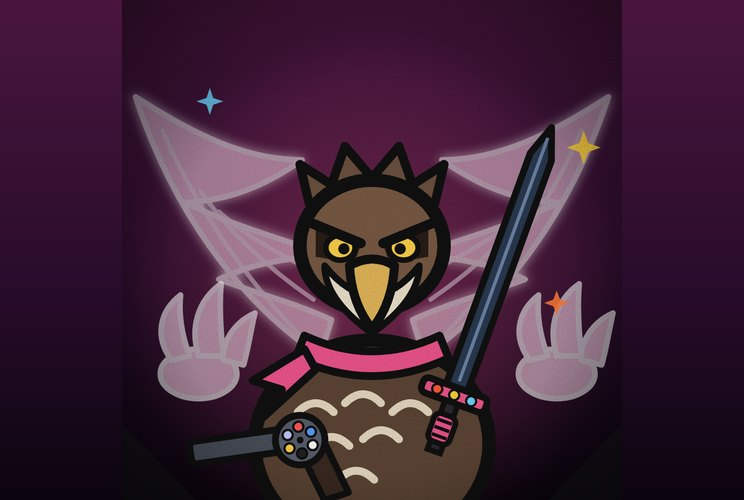

# Gavião Evocador

**Filho do Falcão, Recruta da Águia**

> “Eu nunca luto sozinho. Eles sempre atendem.”

| Lado | Classificação | Função | Série |
|---|---|---|---|
| — | Grau 2 · Espada encantada: Grau 1 | Herói · Recruta da Águia | Temporada 1 |

## Atributos

_Escala de 0 a 5, por postura_

| Atributo | Normal ★ | Espada Crua | Encantada | Asas e Garras |
|---|:-:|:-:|:-:|:-:|
| Força | 3 | 4 | 3 | 4 |
| Velocidade | 4 | 4 | 4 | 5 |
| Inteligência | 3 | 3 | 3 | 3 |
| Resistência | 3 | 3 | 3 | 3 |
| Energia | 4 | 4 | 3 | 2 |
| Destruição | 3 | 4 | 5 | 4 |
| Potencial | 5 | 5 | 5 | 5 |

- **Normal**: Normal
- **Espada Crua**: Espada Crua
- **Encantada**: Espada Encantada
- **Asas e Garras**: Asas e Garras

## Quem ele é

- _Inata_ · **Filho Bastardo do Falcão**  
  Filho bastardo do Falcão Peregrino. Ao contrário do pai, nasceu com energia amaldiçoada.
- _Inata_ · **Recruta da Águia**  
  Foi recrutado pela Águia Disciplinada e luta do lado dos heróis.
- _Técnica_ · **Olho de Falcão**  
  Reflexos e pontaria herdados do pai, sem o corpo sem dom. Ajudam no revólver e na espada.

## Stand: Asas e Garras Fantasmas

- _Técnica_ · **Asas Fantasmas**  
  Duas asas espectrais enormes, como um stand. Servem para voar, bater e se proteger.
- _Técnica_ · **Garras Fantasmas**  
  Duas garras espectrais gigantes que agarram, prendem e rasgam.
- _Técnica_ · **Asas e Garras Juntas**  
  Usa as asas e as garras ao mesmo tempo. Gasta bem mais energia que usar só um par.
- _Técnica_ · **Stand com a Espada**  
  Pode usar as asas e as garras fantasmas ao mesmo tempo que luta com a espada, sem largar nada.
- _Técnica_ · **Clone Fantasma**  
  Faz o stand virar um clone mágico dele, com uma espada fantasma igual à Acelerada, mas sem os bônus. Ele controla o clone enquanto luta. O clone só faz movimentos que o Gavião já fez.

## Evocação

- _Técnica_ · **Evocação**  
  Evoca criaturas, todas elas aves espectrais, que lutam ao lado dele enquanto durar a energia.
- _Evocação_ · **Fantasma-Padre**  
  Um pássaro orador que fica imóvel, com um escudo fraco. Fortalece o Gavião e os aliados o tempo todo.
- _Evocação_ · **Fantasma-Corvo**  
  Um corvo que fica atirando bolinhas de energia.
- _Evocação_ · **Fantasma-Magos-Gêmeos**  
  Dois pássaros obesos que voam e dão escudo mágico um ao outro. O inimigo precisa bater no que está sem escudo. Quando ele leva dano suficiente, ganha o escudo e o outro o perde. Atiram bolas grandes de energia rapidamente e um laser mágico lento. Podem parar de voar para soltar ondas de energia circulares, uma a cada 3 segundos.
- _Evocação_ · **Fantasma-Besta-do-Vórtice**  
  Um pássaro gigante, com muita resistência, que bate corpo a corpo sem parar e atira laser enquanto bate. É uma besta incontrolável: nem o Gavião a controla, e invocá-la é a última opção dele. Pode parar para bater no chão, soltando ondas de energia circulares e vários lasers em todas as direções ao mesmo tempo.

## Espada Acelerada

- _Arma_ · **Espada Acelerada**  
  Lâmina escura, longa e levemente curva, com ponta serrilhada. A guarda parece uma asa de penas afiadas, com detalhes vermelhos. A espada flutua ao lado da asa. Ao bater, ele acelera o cabo, como o acelerador de uma moto: o motor ruge e a lâmina se encanta com fogo, raio ou gelo.
- _Técnica_ · **Três Níveis de Energia**  
  A espada tem 3 níveis de energia, e cada nível melhora o fogo, o raio ou o gelo. Trocar de elemento, incluindo voltar à Crua, zera a carga.
- _Modo_ · **Espada Crua**  
  Se não estiver encantada, a espada está sempre crua. Aumenta o dano puro, sem magia e sem níveis de energia.
- _Técnica_ · **Fogo, Raio e Gelo**  
  O fogo queima e continua queimando. O raio acerta e atordoa. O gelo congela e deixa o alvo lento. Cada nível aumenta o efeito.

## Revólver Seis Penas

- _Arma_ · **Revólver Seis Penas**  
  Revólver mágico de seis tiros que flutua ao lado da asa. As balas são seis penas, uma em cada câmara.
- _Especial_ · **Seis Penas**  
  Vermelha perfura armadura e barreira. Azul persegue o alvo. Branca é silenciosa e sem brilho. Preta ricocheteia até três vezes. Dourada marca o alvo para os aliados. Fantasma atravessa o corpo e fere a energia.
- _Especial_ · **Penas de Volta**  
  As penas disparadas voltam ao tambor depois de alguns segundos, se não forem destruídas. Ele nunca precisa comprar munição.

## Domínio

- _Domínio de expansão_ · **Modo Cerco**  
  A vítima é levada a um cenário enorme, como uma zona de guerra urbana, onde todas as evocações do Gavião estão ao mesmo tempo, sem ele gastar energia para mantê-las ativas. O Modo Cerco acaba quando a vítima mata todos os inimigos ou quando passam 10 minutos.

## Pontos fracos

- _Limitação_ · **Asas e Garras Cobram**  
  Usar os dois pares ao mesmo tempo gasta muita energia, e ele fica sem fôlego rápido.
- _Limitação_ · **Criaturas Gastam Energia**  
  Cada criatura evocada gasta energia enquanto está em campo. Quanto maior a ave, mais caro.
- _Limitação_ · **Troca Zera a Carga**  
  Trocar de elemento, ou voltar à Crua, zera os níveis da espada. Ele tem que carregar de novo desde o começo.
- _Limitação_ · **Crua ou Encantada**  
  Encantar a espada tira o bônus de dano puro. Ele escolhe entre dano puro e magia.
- _Limitação_ · **Clone Só Repete**  
  O clone só faz movimentos que o Gavião já fez. Contra um golpe novo, ele não sabe o que fazer.
- _Limitação_ · **Besta Incontrolável**  
  A Besta do Vórtice não obedece a ninguém e pode atacar quem estiver perto, aliados incluídos.
- _Limitação_ · **Dano Compartilhado**  
  O que atinge as Asas ou as Garras Fantasmas também machuca ele.
- _Fraqueza_ · **Sem o Corpo do Pai**  
  Herdou a mira, mas não as resistências do Falcão. Fogo, raio, gelo e veneno o ferem normalmente.
