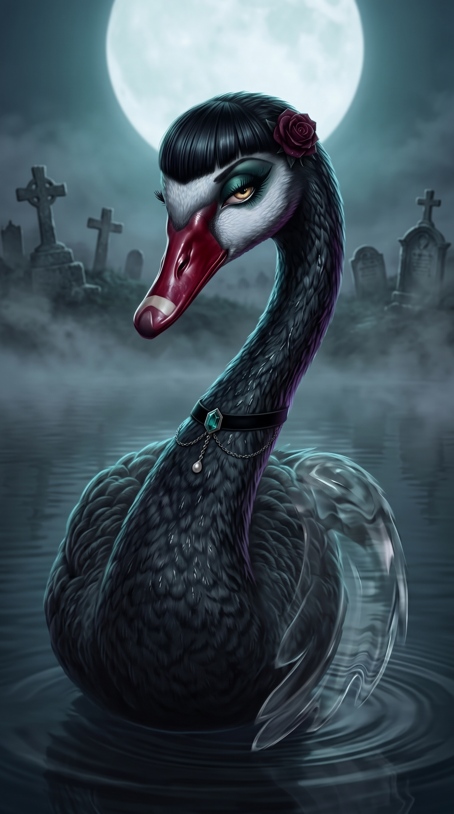

# Invisi-Cisne

**Dama de Preto, Paranoica Invisível**

 

> “Eu sei que alguém está me olhando. Por isso você não me vê.”

| Lado | Classificação | Função | Série |
|---|---|---|---|
| Neutro | Grau 2 · Emboscada: Grau 1 | Neutra · Sem Lado | Temporada 1 |

## Atributos

_Escala de 0 a 5, por postura_

| Atributo | Visível | Invisível ★ |
|---|:-:|:-:|
| Força | 1 | 2 |
| Velocidade | 4 | 4 |
| Inteligência | 4 | 4 |
| Resistência | 1 | 1 |
| Energia | 3 | 3 |
| Destruição | 1 | 3 |
| Potencial | 4 | 4 |

- **Visível**: Visível
- **Invisível**: Invisível

## Quem ela é

- _Inata_ · **Gótica e Sensual**  
  Elegante, lenta e magnética, de preto dos pés à cabeça. Usa a presença e o olhar para desviar a atenção e some antes que alguém lembre dela.
- _Inata_ · **Paranoica**  
  Acha que sempre tem alguém tramando contra ela. Vê armadilha em todo convite, confere todas as saídas e nunca fica de costas para uma porta.
- _Inata_ · **Neutra**  
  Não se compromete com ninguém. Aceita um trabalho, ajuda se for conveniente e se afasta antes de virar aliada de verdade.

## Invisibilidade

- _Técnica_ · **Véu**  
  Fica invisível para as pessoas, para as câmeras ou para os dois ao mesmo tempo. Ela escolhe quem deixa de ver. Véu das Pessoas, Véu das Lentes ou Véu Total.
- _Técnica_ · **Passo Silencioso**  
  Anda, pousa e bate as asas sem fazer barulho nenhum. Passa por quem está atento sem ser ouvida.
- _Técnica_ · **Energia Oculta**  
  Esconde a própria energia amaldiçoada. Quem rastreia por energia não sente que ela está ali.
- _Técnica_ · **Voo Rasante**  
  Voando baixo, rente ao chão, não é detectada pela energia, nem quando está com o Véu desligado.

## Luta

- _Técnica_ · **Golpe Oculto**  
  Sem força, ela bate enquanto está invisível. Mira os pontos fracos: olhos, pescoço, articulações. O golpe a revela por um instante.
- _Técnica_ · **Chuva de Penas Negras**  
  Solta penas finas que ficam invisíveis junto com ela e flutuam ao redor das asas. Disparadas, cortam e fazem sangrar, sem muito dano.
- _Técnica_ · **Passo Fantasma**  
  Quando é descoberta, solta uma nuvem de penas escuras, ativa o Véu Total e some pela saída mais próxima, que ela já tinha escolhido.
- _Técnica_ · **Primeiro Golpe**  
  Escolhe o alvo e a rota de fuga antes de atacar. O primeiro golpe invisível vem sempre pelas costas, e o segundo só se der tempo de sair.

## Pontos fracos

- _Fraqueza_ · **Sem Resistência**  
  Frágil. Um golpe a derruba, e um ataque em área acerta sem precisar enxergar. Ela não aguenta luta aberta.
- _Fraqueza_ · **Revelada ao Bater**  
  Ao atacar, ela aparece por um instante. Quem reage rápido contra-ataca antes de ela sumir de novo.
- _Fraqueza_ · **Eco e Barulho**  
  Ecolocalização mapeia o corpo dela mesmo invisível, como o grito do Morcego e o Escutador. O Passo Silencioso não ajuda contra eco.
- _Limitação_ · **Invisível, Não Intangível**  
  Deixa pegadas na lama e na neve, ondas na água, marcas na poeira e na fumaça. Quem olha o chão a encontra.
- _Limitação_ · **Cada Camada Cobra**  
  O Véu Total gasta bem mais energia que um Véu só. Ela não aguenta uma luta longa invisível.
- _Fraqueza_ · **Paranoia**  
  Foge antes de se comprometer, abandona aliados e missões no meio e vê traição onde não tem. É quase impossível fazê-la ficar.
