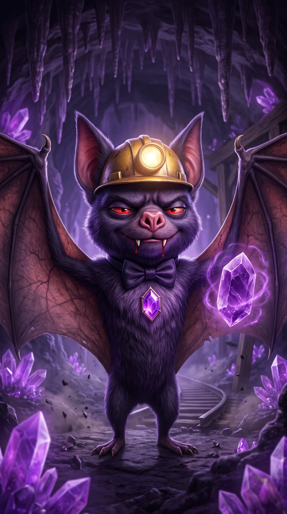
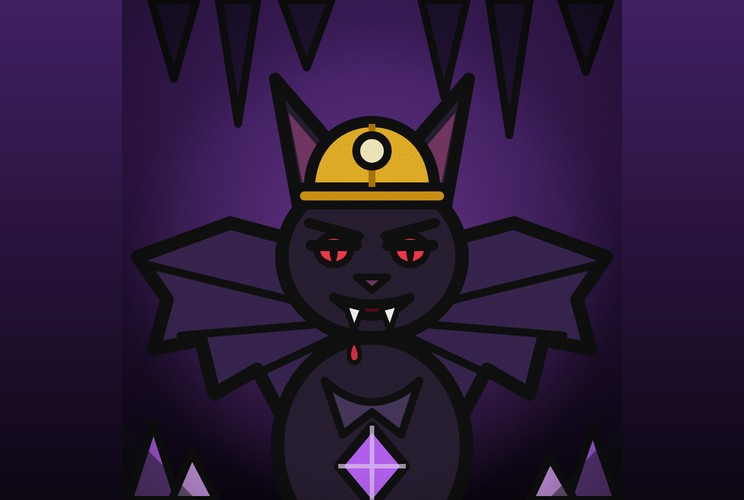

# Morcego Barão

**Herdeiro da Mineração, Fanático por Sangue Puro**

 

> “Ninguém entra na minha caverna sem convite.”

| Lado | Classificação | Função | Série |
|---|---|---|---|
| Neutro | Grau 1 · Gigante: Especial | Neutro · Caverna | Temporada 1 |

## Atributos

_Escala de 0 a 5, por postura_

| Atributo | Normal ★ | Morcego Gigante |
|---|:-:|:-:|
| Força | 3 | 5 |
| Velocidade | 4 | 3 |
| Inteligência | 4 | 2 |
| Resistência | 3 | 5 |
| Energia | 4 | 4 |
| Destruição | 3 | 5 |
| Potencial | 4 | 4 |

- **Normal**: Forma normal
- **Morcego Gigante**: Morcego Gigante

## Quem ele é

- _Inata_ · **Herdeiro da Mineração**  
  Herdeiro do império de mineração da família. Tem dinheiro, equipamentos, minas, túneis e uma caverna cheia de súditos.
- _Inata_ · **Fanático por Sangue Puro**  
  Acredita que só o sangue puro merece respeito. Despreza quem é impuro e trata todo mundo como inferior até provar o contrário.
- _Inata_ · **Noturno**  
  Só sai à noite. Odeia visitas indesejadas na caverna dele e ataca quem entra sem convite.

## Sangue

- _Técnica_ · **Julgamento de Sangue**  
  Ao beber o sangue do alvo, descobre se ele é de sangue puro ou impuro.
- _Técnica_ · **Manipulação de Sangue**  
  Controla o sangue de quem for impuro: trava membros, estanca o movimento ou faz o alvo sangrar. Em quem é puro, não funciona.
- _Transformação_ · **Morcego Gigante**  
  Ao beber sangue puro, vira um morcego gigante. Ganha muita resistência e força, mas perde inteligência e age mais por instinto.
- _Sugestão_ · **Mordida Drenante**  
  Cada mordida faz ele beber o sangue do alvo e recuperar vida. Contra sangue puro, cura mais e alimenta a transformação.
- _Sugestão_ · **Lâmina de Sangue**  
  Molda o sangue de um alvo impuro em lâminas e agulhas e as dispara de volta contra ele.

## Caverna

- _Técnica_ · **Grito de Ecolocalização**  
  Um grito agudo que mapeia o ambiente e mostra a posição de todos, mesmo no escuro. Sem som, sem esconderijo.
- _Território_ · **Chamado da Família**  
  Dentro do território dele, a caverna, chama centenas de morcegos da família. Eles atacam, cercam e tapam a visão, mas não têm os poderes dele.
- _Sugestão_ · **Voo Silencioso**  
  Voa sem fazer barulho nenhum. Ataca pelas costas e some na escuridão antes de ser ouvido.
- _Sugestão_ · **Desabamento**  
  Faz o teto da caverna desabar sobre quem estiver dentro, usando o conhecimento de mineração. Os morcegos da família escapam.
- _Sugestão · Domínio_ · **Galeria Ancestral**  
  Expansão de domínio: toda a mina da família com ele como dono. Dentro, o Julgamento de Sangue acontece sozinho em todos, o grito mostra tudo, e o Chamado da Família não tem limite.

## Pontos fracos

- _Fraqueza_ · **Luz e Dia**  
  Luz forte e sol o cegam e o enfraquecem. De dia ele evita lutar e fica na caverna.
- _Limitação_ · **Precisa do Sangue**  
  Sem beber o sangue do alvo, não faz o Julgamento. Tem que ferir o alvo antes, e quem não deixa ele chegar perto não é julgado.
- _Limitação_ · **Só no Impuro**  
  A Manipulação de Sangue só funciona em sangue impuro. Contra quem tem sangue puro, ele luta no braço.
- _Fraqueza_ · **Gigante Burro**  
  Na forma gigante perde inteligência e cai em armadilha. Precisa de sangue puro para transformar e não tem como fazer isso sem uma vítima assim.
- _Limitação_ · **Longe de Casa**  
  Fora da caverna, o Chamado da Família não funciona. Quem luta com ele longe de casa enfrenta só ele.
- _Fraqueza_ · **Orgulho do Sangue**  
  Subestima quem acha impuro e cai em provocação sobre a pureza dele. Perde a calma quando ofendem a família.
