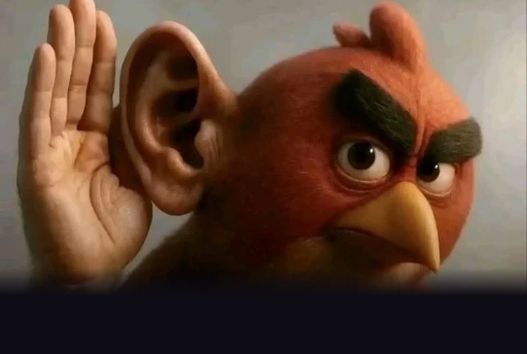
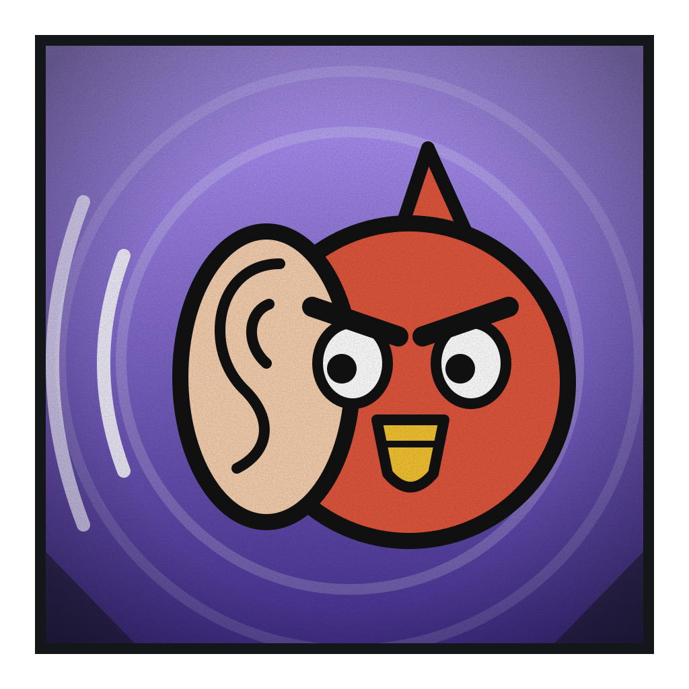

# Passarinho Escutador

**Rastreador de Grau 2**

 

> “Eu ouvi... mas tenho certeza que ele não quis dizer isso.”

| Lado | Classificação | Função | Série |
|---|---|---|---|
| Herói | Grau 2 · Genial, mas confia em todo mundo | Suporte | Temporada 1 |

## Atributos

_Escala de 0 a 5_

| Atributo | Valor |
|---|:-:|
| Força | 1 |
| Velocidade | 3 |
| Inteligência | 5 |
| Resistência | 1 |
| Energia | 3 |
| Destruição | 2 |
| Potencial | 4 |

## Técnicas

- _Inata_ · **Ecolocalização Impecável**  
  Emite sons que voltam e desenham tudo ao redor: formas, posições e movimentos, mesmo no escuro, atrás de paredes ou com invisíveis. Não erra a distância nem por um centímetro.
- _Passiva_ · **Ouvido Absoluto**  
  Ouve sussurros, batimentos e a respiração de longe. Percebe a energia amaldiçoada pelo som que ela faz e sabe quando o corpo de alguém mente.
- _Defesa_ · **Antecipação**  
  Ouve músculos e tendões se preparando e sabe onde o golpe vai cair antes de ele sair. Desvia com folga, se o corpo dele deixar.
- _Ataque_ · **Frequência Quebra-Tudo**  
  Descobre a frequência natural de um corpo, objeto ou técnica e a devolve em um grito. Causa estilhaço e atordoamento, e acerta pontos fracos que ele mesmo achou.
- _Controle_ · **Silêncio Absoluto**  
  Anula todo som em uma área. Esconde os passos dele e dos aliados e silencia técnicas que dependem de voz ou de ordem falada.
- _Equipe_ · **Mapa Compartilhado**  
  Envia o que ouve para os aliados, que passam a ver posições e movimentos do inimigo. É o melhor batedor da equipe.
- _Domínio de expansão_ · **Câmara de Ecos**  
  Dentro dela todo som volta mais alto, e todo golpe, passo ou técnica do inimigo se repete um instante depois contra ele mesmo. O eco sempre acerta, sem desvio. Por ouvir o corpo inteiro do alvo, ele também sabe o que vai fazer a seguir.

## Pontos fracos

- _Limitação_ · **Ingenuidade**  
  Detecta qualquer mentira do corpo, mas confia em quem acredita no que diz. Vilão convicto, que acha que está certo, passa por ele sem alarme.
- _Fraqueza_ · **Ouvido Sensível**  
  Explosões, gritos e barulho alto o ensurdecem e o cegam. Num campo de batalha barulhento, perde o mapa inteiro.
- _Limitação_ · **Corpo Frágil**  
  Sem força e com pouca resistência. Um golpe que acerta o derruba.
- _Custo_ · **Eco Entrega Ele**  
  Os sons que emite denunciam a posição dele. Inimigos que ouvem o eco sabem exatamente onde ele está.
- _Fraqueza_ · **Silêncio Total**  
  Ambientes sem eco ou que absorvem som, como espuma, tecido grosso e vento forte, deixam o mapa dele cheio de buracos.
