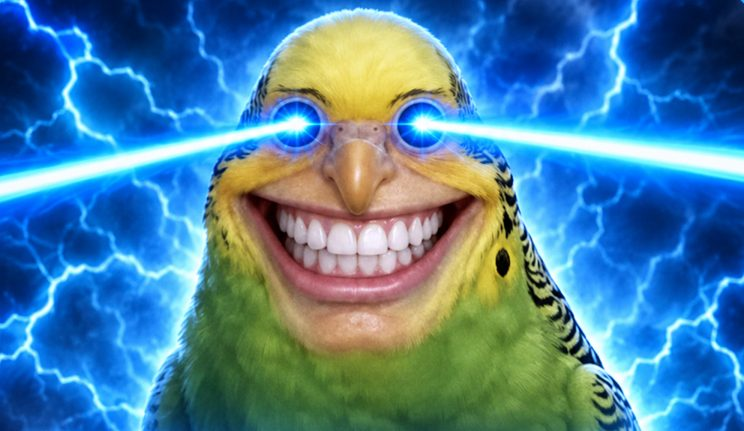
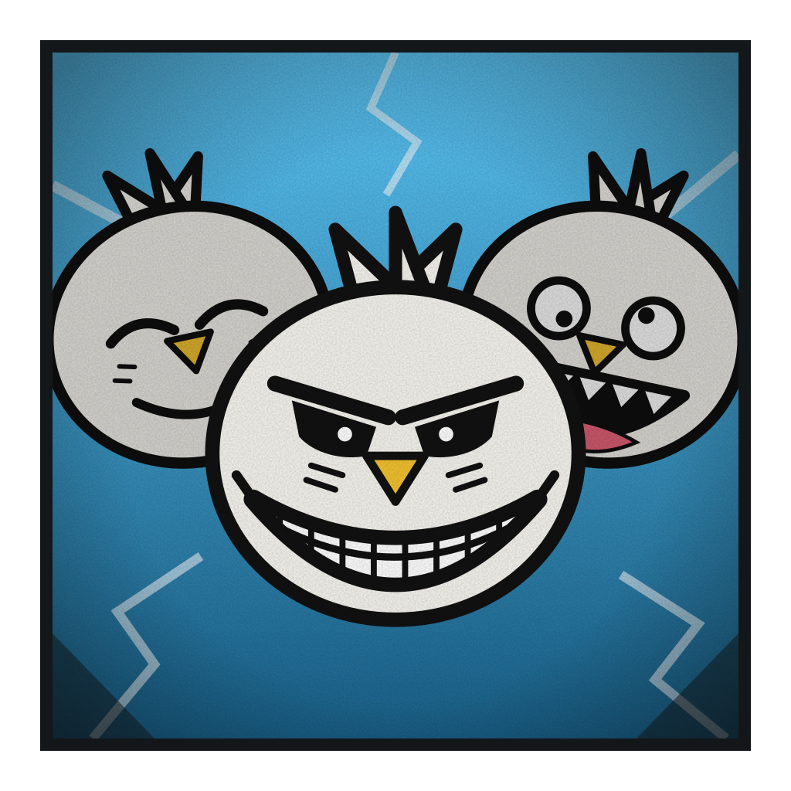

# Passarinho Sorridente

**O Rei das Maldições**

 

> “Eu escrevo as regras depois que você perde.”

| Lado | Classificação | Função | Série |
|---|---|---|---|
| Vilão | Especial | Vilão supremo | Temporada 1 |

## Atributos

_Escala de 0 a 5_

| Atributo | Valor |
|---|:-:|
| Força | 4 |
| Velocidade | 4 |
| Inteligência | 5 |
| Resistência | 4 |
| Energia | 5 |
| Destruição | 5 |
| Potencial | 3 |

## Técnicas

- _Inata_ · **Sorriso Inquebrável**  
  Quanto mais sorri, mais forte fica.
- _Passiva_ · **Aura Malevolente**  
  Envolve o corpo e causa dano contínuo a todos por perto. Cresce quanto mais ele sorri.
- _Corpo_ · **Penas Cortantes**  
  Penas afiadas como lâminas. Cortam de perto e podem ser arremessadas para atacar de longe.
- **Cópia Sacana**  
  Copia uma técnica por vez e cria a versão trapaceira dela.
- **Troca de Corpos**  
  Salta a consciência entre corpos dormentes espalhados pelo mundo.
- **Contrato Sacana**  
  Propõe um acordo cheio de pegadinhas. Quem aceita fica preso às regras dele.
- _Domínio de expansão_ · **Programa do Passarinho**  
  Estúdio infinito de jogos e portas com pegadinha.

## Pontos fracos

- _Limitação_ · **Frase Justificadora**  
  Para usar a versão sacana de um poder, precisa dizer a trapaça em voz alta, sorrindo.
- _Limitação_ · **Penas Esgotadas**  
  Cada pena arremessada abre uma falha na defesa. Gastar demais o deixa sem voo por um tempo.
- _Fraqueza_ · **Brecha nas Regras**  
  Achar a brecha cancela a trapaça e racha o sorriso. No domínio, o domínio quebra.
- _Consequência_ · **Sorriso Quebrado**  
  Sem sorriso, perde a frase, a aura e as versões sacanas dos poderes até regenerar.
- _Fraqueza_ · **Vergonha**  
  Vergonha genuína apaga a aura.
