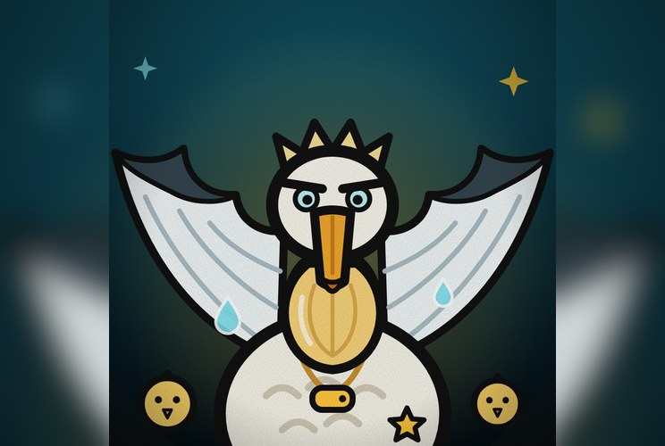

# Pelicano Contensor

**Controle de Multidão**

> “Todo mundo atrás de mim. Hoje ninguém se machuca.”

| Lado | Classificação | Função | Série |
|---|---|---|---|
| — | Grau 2 · Com multidão por perto: Grau 1 | Herói · Enviado do Conselho | Temporada 1 |

## Atributos

_Escala de 0 a 5, por postura_

| Atributo | Patrulha ★ | Escudo Alado | Maré Mansa | Bolsa Cheia |
|---|:-:|:-:|:-:|:-:|
| Força | 3 | 2 | 3 | 3 |
| Velocidade | 2 | 1 | 2 | 1 |
| Inteligência | 4 | 4 | 4 | 4 |
| Resistência | 4 | 5 | 3 | 5 |
| Energia | 4 | 4 | 5 | 3 |
| Destruição | 1 | 1 | 2 | 1 |
| Potencial | 3 | 3 | 3 | 3 |

- **Patrulha**: Patrulha
- **Escudo Alado**: Escudo Alado
- **Maré Mansa**: Maré Mansa
- **Bolsa Cheia**: Bolsa Cheia

## Quem ele é

- _Inata_ · **Enviado do Conselho**  
  O Conselho dos Pássaros o manda quando um vilão aparece em lugar público, cercado de outros pássaros. A missão dele é prender o vilão sem machucar quem está em volta.
- _Inata_ · **Bico-Bolsa**  
  A bolsa do bico estica muito e guarda água, objetos e até um passarinho inteiro. É a base de quase todas as técnicas dele.
- _Técnica_ · **Contenção Branda**  
  A energia dele empurra, prende, molha e cansa, mas quase nunca corta ou explode. O dano em prédios e em inocentes fica perto de zero.
- _Técnica_ · **Proteger Dá Força**  
  Quanto mais inocentes ele protege ao mesmo tempo, mais energia ganha. Por isso rende mais no meio da multidão.

## Controle de multidão

- _Técnica_ · **Contagem de Cabeças**  
  Sente todos os pássaros em volta e sabe quem é inocente e quem é inimigo. Um vilão misturado à multidão não se esconde dele.
- _Técnica_ · **Chamado de Evacuação**  
  Um som grave do bico que acalma o pânico e faz os pássaros saírem em fila pelas saídas. Só guia e acalma, não controla a mente de ninguém.
- _Técnica_ · **Varredura Suave**  
  Passa a asa por perto e leva os inocentes para trás dele num instante, sem machucar. Alcance curto.
- _Técnica_ · **Asas Escudo**  
  Abre as asas como uma muralha larga e segura os golpes que iam atingir a multidão. Fica parado enquanto segura.

## Captura

- _Técnica_ · **Bolsa de Contenção**  
  Recolhe o vilão na bolsa. Lá dentro ele não consegue ferir ninguém de fora. Cabe um vilão forte ou vários fracos, e o tempo depende da energia dele.
- _Técnica_ · **Maré Mansa**  
  Cospe uma onda de água que empurra o vilão e a multidão para longe do perigo, apaga fogo e amortece quedas. A água não machuca.
- _Técnica_ · **Água do Bico**  
  Enche a bolsa com a água que houver por perto: fonte, chuva, rio ou cano estourado. Sem isso, usa só a reserva que carrega.

## Domínio

- _Domínio de expansão_ · **Praça Vazia**  
  Leva o vilão para uma cópia do lugar sem nenhum inocente. Ele só sai quando desiste, desmaia ou o Pelicano fica sem energia.
- _Domínio_ · **Tudo Vira Cansaço**  
  Lá dentro, os golpes do Pelicano não ferem de verdade: viram cansaço. Ele vence esgotando o vilão, não derrubando.
- _Domínio_ · **Tudo se Refaz**  
  O que for quebrado dentro da Praça Vazia volta ao normal quando ela acaba. O lugar de verdade nem chega a ser tocado.

## Pontos fracos

- _Limitação_ · **Pouco Dano**  
  Quase não tem destruição. Um vilão muito resistente ao cansaço demora a cair.
- _Fraqueza_ · **Lento e Pesado**  
  Voa devagar, e pior ainda com a bolsa cheia. Um vilão veloz escapa dele.
- _Limitação_ · **Cobre os Outros**  
  Quando o vilão mira os inocentes, ele toma os golpes no lugar. Gasta Resistência e energia rápido.
- _Limitação_ · **Contagem Cega**  
  Quem esconde a própria energia some da contagem. Ele sente que falta uma cabeça, mas não sabe onde.
- _Limitação_ · **Pânico Quebra o Chamado**  
  Se o medo da multidão for maior que a calma do Chamado, ninguém o ouve. Um vilão que assusta mais que ele anula a técnica.
- _Limitação_ · **Água Necessária**  
  Sem água por perto, a Maré Mansa e a Bolsa de Contenção ficam fracas.
- _Limitação_ · **Bolsa Tem Limite**  
  Um vilão forte pode rasgar a bolsa por dentro, e a dor volta para o Pelicano.
- _Fraqueza_ · **Sem Plateia, Sem Força**  
  Sozinho, num lugar vazio, ele é só Grau 2 e perde o ganho de Proteger Dá Força. A Praça Vazia gasta toda a energia que juntou.
