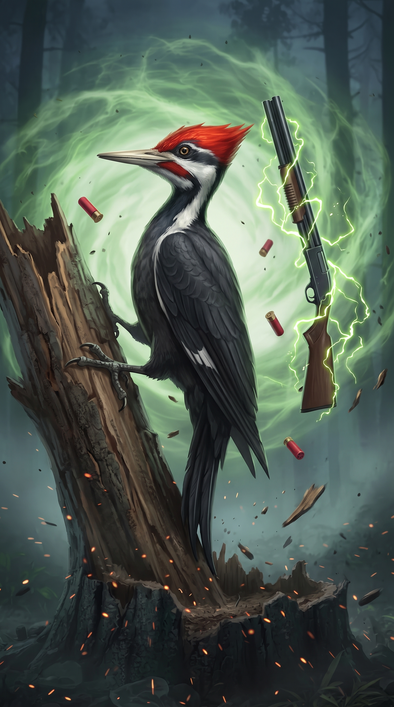
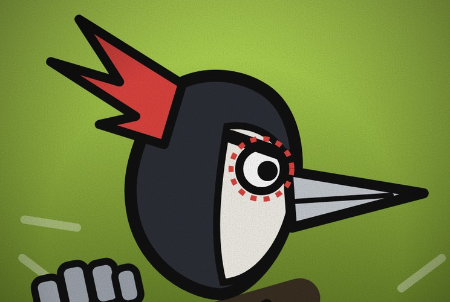

# Pica-Pau Cartucho

**Casca de Bala de Grau 1**

 

> “Pode vir. Eu não paro de bater!”

| Lado | Classificação | Função | Série |
|---|---|---|---|
| Vilão | Grau 1 · Cada golpe o deixa mais perigoso | Parceiro | Temporada 1 |

## Atributos

_Escala de 0 a 5_

| Atributo | Valor |
|---|:-:|
| Força | 4 |
| Velocidade | 4 |
| Inteligência | 2 |
| Resistência | 3 |
| Energia | 4 |
| Destruição | 5 |
| Potencial | 4 |

## Técnicas

- _Inata_ · **Foco**  
  Quanto mais ele bate e fica perto do inimigo, mais Foco ele ganha, até 3 níveis. Perde um nível se parar de bater, correr ou se afastar do inimigo, e perde todo o Foco se levar um golpe. Trocar de arma não faz perder.
- _Ferramentas_ · **Armas Amaldiçoadas**  
  Usa a própria mana para alimentar armas amaldiçoadas. Cada arma tem uma Ultimate que só sai no Foco 3, e depois dela o Foco volta a zero.
- _Domínio de expansão_ · **Estande de Tiro**  
  Dentro, cada golpe dele conta como um tiro certeiro que não dá para desviar nem bloquear, e o Foco sobe sem precisar de contato. Depois de uma Ultimate, o Foco volta ao nível 2, e não a zero. O estande tem 12 disparos, e quando acabam o domínio termina.

## Níveis de Foco

- _Foco I_ · **Mira**  
  Reflexos e pontaria melhores. Os golpes ficam mais precisos.
- _Foco II_ · **Ritmo**  
  Mais força e velocidade. Ele passa a ver as brechas do inimigo.
- _Foco III_ · **Estouro**  
  Libera a Ultimate da arma em mãos. Gasta muita mana e zera o Foco.

## Arsenal e Ultimates

- _Luva e bota_ · **Beowulf**  
  Luva e bota como as do Balrog, sem fogo, mas com poder bruto bem maior. Ultimate, Soco Sísmico: uma pancada no chão que causa uma onda fortíssima.
- _Motosserra_ · **Madeireira**  
  Corta tudo que for sólido. Ultimate, Corte Raso: corta num arco enorme tudo o que estiver à frente, como uma derrubada.
- _Escopeta_ · **Doze**  
  Escopeta de calibre 12 que ele carrega na cartucheira. Ultimate, Rajada de Cascas: dispara todas as cascas de uma vez, e cada uma explode ao tocar em algo.
- _Estoque_ · **Agulha**  
  Arma rápida e precisa. Ultimate, Mil Agulhas: em poucos segundos dá centenas de estocadas num único alvo.
- _Escudo_ · **Muralha**  
  Defesa pesada. Ultimate, Muro Final: ergue um muro indestrutível que devolve o dano de quem o ataca.
- _Corrente_ · **Cadeia**  
  Arma de controle. Ultimate, Prisão de Ferro: prende o alvo e o puxa para o golpe final.

## Pontos fracos

- _Limitação_ · **Depende de Contato**  
  O Foco só sobe de perto. Inimigos de longe ou voadores o atrapalham.
- _Limitação_ · **Foco Frágil**  
  Perde um nível se parar de bater, correr ou se afastar do inimigo, e perde tudo se levar um golpe. Quem o acerta ou o faz correr o desarma.
- _Custo_ · **Ultimate Cobra Mana**  
  Cada Ultimate gasta muita mana e o deixa exausto logo depois.
- _Fraqueza_ · **Ultimates Previsíveis**  
  São enormes, e o inimigo vê o preparo e se afasta.
- _Fraqueza_ · **Dependência das Armas**  
  Sem armas só sobra o Foco, que não tem nada para soltar.
- _Limitação_ · **Falastrão**  
  Fala demais e entrega a jogada antes de agir.
