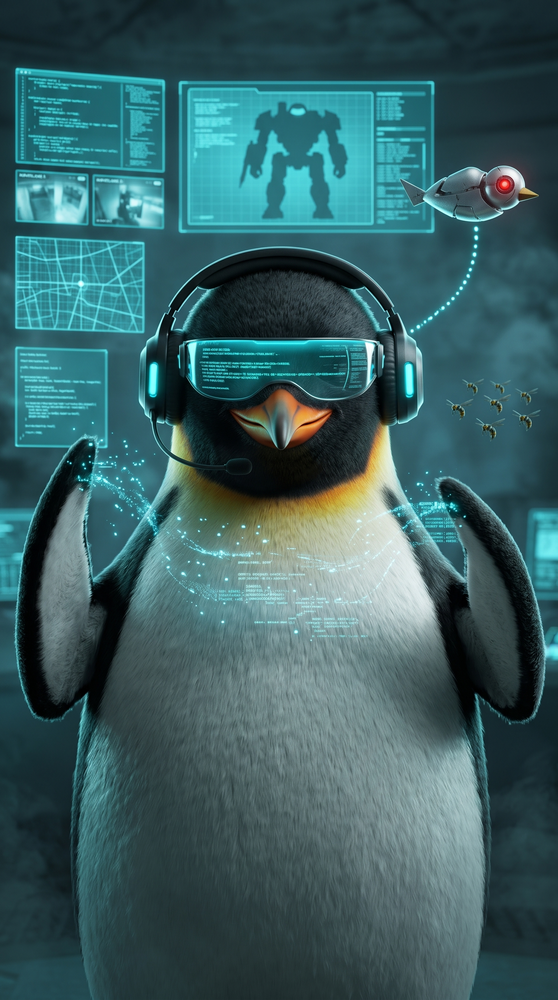
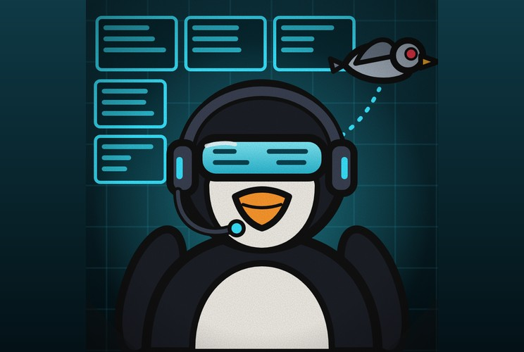

# Pinguim Lenda

**Hacker de Base de Grau 1**

 

> “Já estou dentro.”

| Lado | Classificação | Função | Série |
|---|---|---|---|
| Herói | Grau 1 | Hacker · Suporte | Temporada 1 |

## Atributos

_Escala de 0 a 5_

| Atributo | Com mechas e canal | Sem mechas |
|---|:-:|:-:|
| Força | 1 | 1 |
| Velocidade | 2 | 2 |
| Inteligência | 5 | 3 |
| Resistência | 2 | 2 |
| Energia | 5 | 3 |
| Destruição | 3 | 2 |
| Potencial | 5 | 5 |

## Base

- _Inata_ · **Acesso**  
  Lê a energia amaldiçoada como código: enxerga o fluxo, as regras e os pontos de entrada de cada técnica. Tudo o que ele faz é dar comandos em cima dessa leitura.
- _Inata_ · **Sala de Controle**  
  Nunca luta de frente. Fica sempre dentro da base, cercado de telas, e age à distância por mechas e comunicadores.
- _Técnica_ · **Varredura**  
  Qualquer alvo visto pelo Dedo-duro ou por um aliado com comunicador fica mapeado: técnica, ritmo de energia e ponto fraco. Os ataques dele dependem disso.

## Comunicação

- _Técnica_ · **Linha Direta**  
  Fala e escuta por objetos amaldiçoados que o time carrega como comunicadores. Funciona em tempo real, mesmo a longa distância.
- _Suporte_ · **Olho na Tela**  
  Passa aos heróis, durante a luta, o que a Varredura mostrou: técnicas inimigas, posições, pontos fracos e rotas de fuga.
- _Técnica_ · **Grampo**  
  Escuta o que acontece em volta de qualquer comunicador, mesmo desligado, e também o que os mechas ouvem.
- _Utilidade_ · **Rastreio**  
  Segue o rastro de energia de qualquer alvo mapeado e o localiza pelo Dedo-duro, que fareja a energia. Serve para achar os corpos do Passarinho Sorridente.

## Mechas

- _Regra_ · **Comando dos Mechas**  
  Controla um mecha por vez no comando fino. Os outros seguem ordens simples ou ficam parados. Se um é destruído, perde só a máquina, mas gasta energia para refazer.
- _Mecha_ · **Bando de Marimbondos**  
  Sete drones que andam sempre juntos e obedecem ao que o Pinguim estiver controlando. Se ele não estiver no comando, agem em mente de colmeia, no modo automático, e atacam em bando.
- _Primeiro mecha_ · **Colosso**  
  Mecha pesado e blindado, com garra-martelo, asa-escudo e canhão no peito. É o tanque do bando e o mais caro de refazer.
- _Mecha_ · **Garra**  
  Mecha quadrúpede em forma de cão de caça, rápido e ágil. Ataca de curta distância com garras e lâminas retráteis e usa a Força Bruta para abrir a defesa do alvo.
- _Mecha_ · **Dedo-duro**  
  Pequeno e discreto. Voa, serve de olhos e ouvidos, faz a Varredura e fareja a energia dos alvos. É por ele que o Rastreio funciona.
- _Mecha_ · **Canhão Orbital**  
  Só funciona ativado à mão. O Pinguim precisa trocar para ele e perde a visão de tudo. O tiro demora 5 segundos para carregar, e nesse tempo todos os outros mechas desligam. Depois de atirar, ele perde a comunicação e o controle dos mechas, e leva muito tempo para a energia amaldiçoada voltar e ele reconectar.

## Ataques por mecha

- _Ataque_ · **Força Bruta**  
  Testa combinações até abrir a defesa do alvo mapeado: quebra barreiras, selos, escudos e armaduras.
- _Ataque_ · **Erro 404**  
  Injeta um comando em uma técnica mapeada no meio do uso. Ela falha e não acontece, uma vez por alvo.
- _Ataque_ · **Sobrecarga**  
  Um pulso dos mechas atordoa os alvos mapeados e os deixa sem usar técnica por alguns segundos.
- _Ataque_ · **Lag**  
  Atrasa a percepção e o movimento do alvo mapeado. Ele reage um instante tarde.
- _Técnica_ · **Varredura Auspex**  
  Pelo Dedo-duro, marca uma área que demora para carregar. Quem estiver dentro sofre dano crítico garantido. Depois de posta, a área fica fixa. Quem sair continua escaneado por 3 segundos, ainda suscetível ao dano crítico.
- _Expansão de domínio_ · **Servidor Raiz**  
  Abre uma área ao redor de um mecha, onde ele é administrador. Cada alvo mapeado tem uma técnica bloqueada (Acesso Negado), e ele edita as regras locais, como velocidade e gravidade. Se o mecha central cair, o domínio fecha.

## Pontos fracos

- _Fraqueza_ · **Corpo Indefeso**  
  Força e resistência baixas. Se acharem a base, ele cai fácil. Quem rastrear o sinal dos mechas chega até ele.
- _Limitação_ · **Comunicador Quebrado**  
  Sem o comunicador, ele perde o canal com aquele aliado. Se um inimigo tomar um, escuta o time.
- _Fraqueza_ · **Sem Energia, Sem Código**  
  Quem não tem energia amaldiçoada não tem o que mapear. Contra o Falcão Peregrino, quase nada funciona.
- _Limitação_ · **Precisa Mapear**  
  Sem Varredura os ataques dele não funcionam. Quem bloquear a visão dos mechas o deixa fraco.
- _Custo_ · **Cego e Mudo**  
  Ao trocar para o Canhão Orbital, perde a visão de tudo e deixa os outros mechas desligados por 5 segundos. Depois do tiro, fica sem comunicação com o time por muito tempo.
- _Limitação_ · **Auspex Fixa**  
  A área da Varredura Auspex demora para carregar e não se move. Quem percebe, evita.
- _Custo_ · **Sobreaquecimento**  
  Controlar vários mechas, perder máquinas e abrir o domínio esgota a energia e o deixa sem resposta por um tempo.
