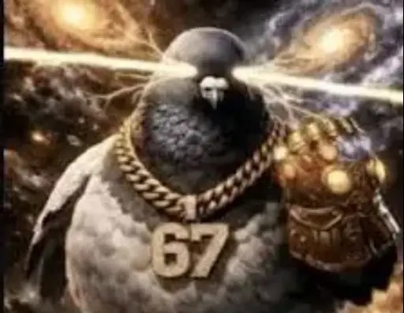
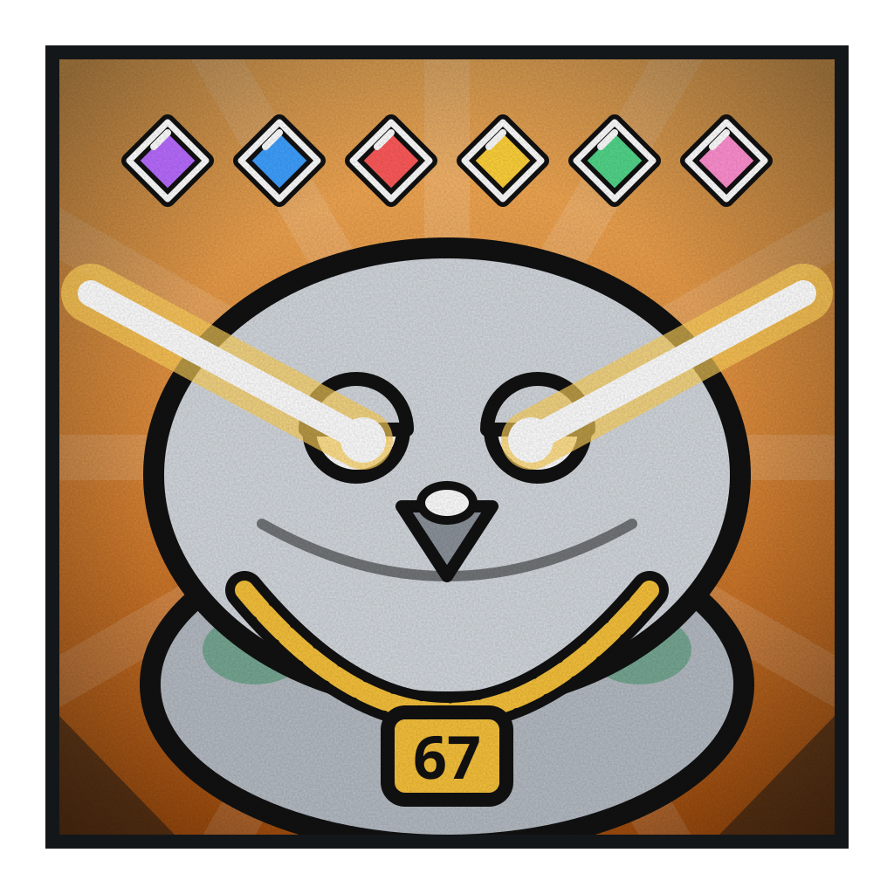

# Pombo Aurudo

**Agente Livre de Grau Especial**

 

> “Alexa, ligar aura.”

| Classificação | Função | Série |
|---|---|---|
| Especial · Sem a manopla: Grau 3 | Mercenário | Temporada 1 |

## Atributos

_Escala de 0 a 5_

| Atributo | Com a manopla | Sem a manopla |
|---|:-:|:-:|
| Força | 5 | 1 |
| Velocidade | 3 | 1 |
| Inteligência | 3 | 3 |
| Resistência | 4 | 2 |
| Energia | 5 | 1 |
| Destruição | 5 | 3 |
| Potencial | 2 | 2 |

## Técnicas

- _Inata_ · **Laser Nativo**  
  Raios que saem dos olhos. É o único poder que é dele, mesmo sem a manopla.
- _Ferramenta_ · **Manopla das Joias**  
  Ferramenta amaldiçoada de Grau Especial com seis joias. De onde vem quase todo o poder dele.
- _Comando_ · **Ligar Aura**  
  Comando de voz liberado quando a aura enche. Leva a manopla ao máximo por pouco tempo e o deixa exausto.
- _Domínio de expansão_ · **Praça do Atalho**  
  Praça de mil caminhos curtos que sempre voltam ao começo. Todo esforço da vítima é desfeito, e a energia que ela gastou vira dano nela e carga para o Pombo. Não depende da manopla.

## Joias da manopla

- **Joia do Poder**  
  Laser contínuo ou disparo único, mais forte que o nativo. Reforça passivamente a resistência e os golpes. Gastar energia reforça também a força e o poder de fogo.
- _Joia do Poder_ · **Escudo**  
  Cria um escudo em volta dele ou de outras pessoas, mesmo de longe.
- **Joia do Espaço**  
  Voo mais rápido, estável e flexível. Teletransporta para qualquer lugar visível ou já visitado. Quanto mais longe, mais energia.
- **Joia da Mente**  
  Lê a mente dos outros e envia mensagens telepáticas. Cria um elo mental para ver, ouvir e sentir o que a pessoa sente, mas o elo só funciona com a aprovação dela.
- **Joia da Alma**  
  Transfere energia para curar a si ou outros de longe, ou converte vida em energia. Quem doa precisa concordar. Sem acordo, ele rouba a força no combate.
- **Joia da Realidade**  
  Cria coisas pela imaginação ou muda o estado de algo, como um anel de lanterna. Gasta mais energia que todas, menos o tempo.
- **Joia do Tempo**  
  Desacelera, para e até volta o tempo. Gasta energia demais.

## Energia em combate

- _Defesa_ · **Escudo Faminto**  
  Quando o escudo segura um golpe, parte do dano vira energia para ele. Golpe forte demais quebra o escudo e não rende nada.
- _Joia da Alma_ · **Soco que Rouba**  
  Cada golpe que acerta puxa um pouco da energia do alvo. Exige contato, o que o deixa perto do perigo.
- _Acúmulo_ · **Medidor de Aura**  
  Golpes dados, recebidos e bloqueados enchem a aura. Cheia, libera o Ligar Aura.
- _Equipe_ · **Doação dos Aliados**  
  Aliados podem doar energia pela Joia da Alma. Isso faz deles uma bateria viva.
- _Recarga_ · **Migalhas**  
  Fora da luta, recarrega comendo pão e migalhas. É por isso que ele não para de comer.

## Pontos fracos

- _Limitação_ · **Dependência Total**  
  Sem a manopla, perde força, velocidade e energia. Só sobram o laser e a Praça do Atalho.
- _Limitação_ · **Voo Emprestado**  
  Só voa pela Joia do Espaço. Parou de treinar e as asas não aguentam mais sozinhas.
- _Limitação_ · **Corpo Obeso**  
  Lento, sem fôlego e com pouca energia própria. Cansa rápido depois de qualquer esforço.
- _Limitação_ · **Energia Roubada Dissipa**  
  A energia que ele rouba ou recebe se perde rápido se não for usada. Guardar demais o deixa enjoado.
- _Custo_ · **Joias Cobram**  
  Cada joia gasta a energia dele. As mais fortes o deixam parado em poucos usos.
- _Fraqueza_ · **Manopla Tomável**  
  Quem tirar a manopla do braço dele vence a luta.
